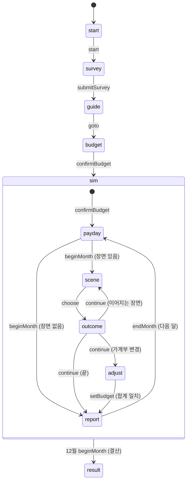

# 모듈 API 명세 (`packages/core`, `packages/draft-kit`)

- 작성일: 2026-10-26
- 수정일: 2026-11-09 (수업 모드 승인 변경 반영: `docs/live-classroom-plan.md` §13 1~9 + `step()`. 세부는 이 문서가, 수업 모드 계약은 `docs/live-api.md`가 담당)
- 대상: 화면 앱(`src`)과 이후 엔진 구현
- 규칙의 근거: `가계부-시나리오-수업-기획서.md` 4~6장

## 1. 저장소 구조

```
.
├── 가계부-시나리오-수업-기획서.md
├── docs/
│   ├── core-api.md          이 문서
│   ├── design-brief.md      디자인 시안 요구사항 (비교 단계 기록)
│   └── design-review.md     시안 비교 기록 (src1 '통장 정리' 채택)
├── packages/
│   ├── core/                화면과 무관한 순수 TypeScript (타입, 데이터, 계산, 엔진, 목업)
│   │   └── src/
│   │       ├── types.ts     모든 공용 타입
│   │       ├── format.ts    금액·날짜 표기
│   │       ├── selectors.ts 상태 → 화면용 값 계산
│   │       ├── engine.ts    상태 생성, 추천 가계부, step (미구현)
│   │       ├── fixtures.ts  목업 스냅숏 상태
│   │       └── data/        이벤트, 설문, 안내, 계좌, 상태, 도전과제, 엔딩, 프롬프트, 상수
│   └── draft-kit/           스냅숏 네비게이터 셸 (디자인 대상 아님)
├── src/                     화면 앱 (Vite + React + TypeScript + Tailwind CSS v4)
└── scripts/                 스크린숏, 단일 HTML 빌드, 정적 서버
```

명령

| 명령 | 내용 |
| --- | --- |
| `pnpm install` | 의존성 설치 |
| `pnpm dev` | 화면 앱 개발 서버 (Vite 기본 포트 5173) |
| `pnpm typecheck` | 전체 타입 검사 |
| `pnpm build` | 전체 빌드 |
| `pnpm shots [--only=id1,id2] [--viewports=laptop,tablet,tabletPortrait,phone]` | `shots/<스냅숏>--<화면크기>.png` 생성. 페이지 오류가 있으면 종료 코드 2 |

화면 앱은 `@gagyebu/core`와 `@gagyebu/draft-kit`을 소스 그대로 가져다 씁니다 (별도 빌드 없음). 모든 import는 패키지 루트에서 합니다.

```ts
import { FIXTURES, formatMan, budgetSummary, EVENTS, type GameState } from '@gagyebu/core';
import type { ScreenProps } from '@gagyebu/draft-kit';
```

> 2026-11-09 이후 `ScreenProps` 계약은 수업 모드용으로 바뀐다(§2.1 참조). 이 문서는 core의 계약을 정하고, 새 `ScreenProps`·어댑터의 정식 명세는 `docs/live-api.md` §10.8~10.9에 있다.

## 2. 화면 앱과의 계약

### 2.1 화면 컴포넌트

각 화면 앱은 6개 화면 컴포넌트를 `ScreenMap`으로 넘깁니다. `src/src/App.tsx`에 이미 연결되어 있습니다.

```ts
type ScreenId = 'start' | 'survey' | 'guide' | 'budget' | 'sim' | 'result';

interface ScreenProps {
  state: GameState;     // 스냅숏의 상태 (복사본이라 화면 안에서 고쳐도 됨)
  ui: FixtureUi;        // GameState에 없는 화면 내부 상태 힌트
  fixture: Fixture;     // id, label, note
  go: (fixtureId: string) => void;      // 다른 스냅숏으로 이동
  goScreen: (screen: ScreenId) => void; // 그 화면의 첫 스냅숏으로 이동
}

interface FixtureUi {
  startStage?: 'name' | 'reveal';
  surveyIndex?: number;     // 0~6 질문, 7 결과
  guideIndex?: number;      // 0~5
  openChoiceId?: string;    // 지불·입금 패널이 열린 선택지
  presentation?: boolean;   // 결과 화면 발표용 크게 보기
}
```

**수업 모드 전환 후의 `ScreenProps`.** 수업 모드가 들어오면 화면은 `go`/`goScreen` 대신 `dispatch`·`draft`·`submitted`·`mode`를 받습니다. 새 계약의 정식 명세는 `docs/live-api.md` §10.8에 있고, draft-kit은 스냅숏 셸을 그대로 유지하는 어댑터를 제공합니다(live-api.md §10.9). core의 `Action`이 두 계약에서 같은 정의를 쓰는 것이 이 문서의 책임입니다.

- 주소는 `#/<스냅숏 id>`입니다. `?shot`을 붙이면 네비게이터가 숨겨집니다 (스크린숏용).
- 네비게이터: 오른쪽 아래 버튼, `` ` `` 키로 열고 닫기, `[` `]` 키로 이전/다음 스냅숏.
- 스냅숏이 바뀌면 화면 컴포넌트가 새로 마운트됩니다 (`key`가 스냅숏 id).

### 2.2 엔진 연결 전에 지킬 것

- `step()`의 정식 명세는 아래 4장입니다(2026-11-09 기준). **구현 완료(2026-11-08, M1·M1')** — `step`·`canStep`·§4.3 함수가 모두 동작한다. 화면은 지금도 `state`와 `ui`로 그립니다.
- 입력, 패널 열기, 금액 나누기 같은 화면 안의 상호작용은 컴포넌트 로컬 상태로 흉내 냅니다. 계산은 아래 선택자를 씁니다.
- 다음 단계로 넘어가는 버튼은 `go()`나 `goScreen()`으로 그럴듯한 다음 스냅숏에 연결합니다. 예: 설문 결과의 "다음" → `goScreen('guide')`, 2월 장면의 "수리한다" → 로컬로 지불 패널 열기, 확정 → `go('sim-feb-outcome')`.
- 금액은 직접 계산하지 말고 `selectors.ts`와 `format.ts`를 씁니다.

## 3. 타입 요약

전체 정의는 `packages/core/src/types.ts`에 있습니다. 화면에서 자주 쓰는 것만 정리합니다.

### 3.1 계좌와 가계부

| 타입 | 내용 |
| --- | --- |
| `AccountId` | `living` 생활비, `emergency` 비상금, `savings` 적금, `invest` 투자, `goal` 목표, `housing` 청약 |
| `TransferAccountId` | `living`을 뺀 자동이체 대상 5개 |
| `ExpenseId` | `rent` `phone` `insurance` `transport` `subscription` (고정비), `food` `household` `beauty` `leisure` `family` (변동비) |
| `Budget` | `{ transfers: Record<TransferAccountId, Won>, expenses: Record<ExpenseId, Won>, livingBuffer: Won }` |
| `BudgetSummary` | `budgetSummary()` 결과: 자동이체 합계, 지출 합계, 고정/변동 합계, 생활비 입금액, 남은 금액(0이어야 확정), 저축률, 계좌별 비율 |
| `BudgetIssue` | `over` 초과 / `under` 미달 / `negative` 음수 항목 |

생활비 통장 입금액 = 지출 예산 합계 + 여유분. 월급 = 자동이체 합계 + 생활비 입금액이어야 가계부를 확정할 수 있습니다.

### 3.2 게임 상태 `GameState`

| 필드 | 내용 |
| --- | --- |
| `phase` | `start` `survey` `guide` `budget` `sim` `result` |
| `profile` | 닉네임, 배정된 월급, 기준 월급 |
| `survey` | 답변, 결과(유형, 점수, 추천 가계부) |
| `initialBudget`, `budget` | 처음 확정한 가계부, 현재 가계부 |
| `month`, `step` | 현재 월(1~12)과 그 달 안의 단계 (아래 4.2) |
| `payday` | 이번 달 월급날 처리 내역: 자동이체, 생활비 입금·지출, 할부 상환, 이자·수익, 상태 효과, 생활비 부족분 |
| `accounts` | 계좌별 `{ balance, contributed, earned }` |
| `savings` | 적금 납입 횟수, 해지 여부 |
| `debts` | 할부·카드값·리볼빙 목록 (`remaining`, `monthly`, `monthsLeft`) |
| `statuses` | 지속 효과 (`STATUSES`에 정의). `note`에 "현재 시세 42만 원" 같은 문구 |
| `satisfaction` | 0~100, 시작 60 |
| `credit` | 0~1000, 시작 850 |
| `queue`, `current` | 이번 달에 남은 장면, 지금 장면 |
| `lastOutcome` | 마지막 선택의 결과 (피드백, 변화 목록, 이어지는 장면, 교훈, 가계부 조정 이유) |
| `scheduled` | 몇 달 뒤로 예약된 장면과 예고 문구 |
| `history` | 끝난 달마다 순자산, 계좌 잔고, 부채, 만족도, 신용점수 |
| `decisions` | 선택 기록 (월, 이벤트 코드, 선택지 이름, 지불 내역, 태그). 자동 처리된 선택은 `auto: true` (2026-11-09 추가, §4.2) |
| `budgetEdits` | 가계부를 조정한 횟수 |
| `unlocked` | 달성한 도전과제 |
| `settlement` | 12월 결산: 적금 만기(세전·세후), 최종 잔고, 순자산, 부채, 엔딩, 도전과제 목록, 가계부 전후 비교 |

### 3.3 이벤트 (로그라이크식 장면 그래프)

```ts
interface GameEvent {
  id: EventId; code: string; type: EventType; month: MonthNo;
  title: string; summary: string; lesson: string; promptId?: PromptId;
  entry: SceneId; entryVariants?: { when: Condition; scene: SceneId }[];
  scenes: Record<SceneId, Scene>;
}
interface Scene {
  id: SceneId;
  channel: 'narration' | 'messenger' | 'sms' | 'news' | 'app';
  speaker?: string; title?: string; text: string;
  reveal?: { label: string; value: string }[];   // 이 장면에서 공개되는 숫자
  choices: Choice[];
}
interface Choice {
  id: string; label: string; detail?: string;
  kind: 'pay' | 'fixedPay' | 'free' | 'deposit' | 'gamble' | 'budget';
  pay?: PaySpec; fixedPay?: FixedPaySpec; deposit?: DepositSpec;
  requires?: Condition; lockedReason?: string;
  fallback?: true;   // 2026-11-09 추가. 이 장면의 기본 선택지
  effects?: Effect[]; next?: NextScene; feedback: string; tags?: ChoiceTag[];
}
```

**`fallback?: true` (2026-11-09 추가).** 그 장면의 "대놓고 나빠 보이는" 기본 선택지 표시입니다. 규칙:

- 모든 장면에 **정확히 하나** 있어야 하고, `requires`(잠김 조건)가 없어야 합니다(테스트로 보장, §4.4).
- 선택지가 하나뿐인 확인 장면(`welcome`, `aftermath`, `vanished`)은 그 선택지가 기본값입니다.
- 학생도 직접 고를 수 있고, 화면에서 다른 선택지와 생김새가 같습니다(색·순서·크기 힌트 없음). 이 선택지가 기본값이라는 사실은 학생 화면에 표시하지 않습니다.
- 서버의 기본값 처리는 `fallbackChoice(scene)`(§4.3)로 이 선택지를 찾습니다.
- 장면별 지정·새 선택지 목록은 부록 A(문서 끝)에 있습니다.

| `Choice.kind` | 화면 동작 |
| --- | --- |
| `pay` | 지불 패널: `fundingOptions()`로 수단별 한도·경고를 받아 여러 계좌로 나눠 내기. 카드면 `cardMonths` 중 할부 개월 선택. `adjustable`이 있으면 금액도 고름. `to`가 있으면 지출이 아니라 계좌 이동 |
| `fixedPay` | 확인 단계: `fixedPay.label`(예: "12개월 무이자 할부, 매달 12.5만 원")을 보여 주고 확정 |
| `free` | 바로 결과 |
| `deposit` | 입금 패널: `resolveAmount()` 금액을 `targets` 중 한 계좌에 넣기 |
| `gamble` | 결과가 다음 장면이나 몇 달 뒤로 이어짐. `pay`가 함께 있으면 지불 패널 먼저 |
| `budget` | 결과 뒤 가계부 조정 단계로 (`openBudget` 효과의 `reason` 표시) |

`next.delayMonths`가 없으면 같은 달에 바로 다음 장면이 이어지고, 있으면 그 달로 예약됩니다. `next.when`은 예약된 달 월초에 다시 판정합니다.

중요: 선택지를 좋은 것과 나쁜 것으로 색칠하거나 순서로 암시하지 않습니다. 학생이 스스로 판단해야 합니다. 잠긴 선택지(`requires`)와 지불 수단 경고는 보여 줍니다.

## 4. 엔진 (`engine.ts`)

### 4.1 구현된 함수

| 함수 | 내용 |
| --- | --- |
| `rollSalary(random?, base?)` | 기준 월급 ±10%, 1만 원 단위 |
| `createInitialState(nickname, salary)` | 시작 상태 |
| `classifySpending(answers)` | 소비 성향 유형과 점수 |
| `recommendBudget(answers, salary)` | 추천 가계부가 담긴 `SurveyResult` |
| `emptyBudget()`, `emptyAccounts()` | 빈 값 |

### 4.2 `step(state, action)` (명세 확정: 2026-11-09, 구현 완료: 2026-11-08)

`useReducer(step, initial)`에 그대로 연결하는 순수 함수입니다. 구현 결정은 §4.5에 기록했다.

**순수성·결정성.** `step`은 `Math.random`·`Date.now`·I/O를 쓰지 않습니다. 유일한 난수인 월급은 `start` 행동의 `salary` 값으로 **호출자가 주입**합니다(서버는 `rollSalary()`로 정해 넣고 로그에 남깁니다). 같은 `(state, action)`에 대해 항상 같은 결과를 반환하고, 원본 `state`는 고치지 않습니다. 그래서 서버 로그 재생이 곧 상태 복원입니다.

```ts
/** 조건을 어기면 던지는 예외 */
export class StepError extends Error {
  readonly code: StepErrorCode;
  constructor(code: StepErrorCode, message: string);
}

export type StepErrorCode =
  | 'invalid-phase'    // 지금 phase에서 쓸 수 없는 행동
  | 'invalid-step'     // 시뮬레이션 안 단계가 맞지 않음 (예: 장면 없는 상태에서 choose)
  | 'unknown-choice'   // 현재 장면에 없는 선택지
  | 'choice-locked'    // requires 조건을 못 채움
  | 'budget-invalid'   // 합계가 맞지 않거나 음수 항목
  | 'payment-invalid'  // 지불 계획 검증 실패 (validatePayment와 같은 이유)
  | 'already-finished'; // phase 'result' 뒤의 행동 (reset 제외)

/** 행동을 적용할 수 있는지 미리 검사. 실패 이유 문구를 돌려준다. 서버의 allowed 검사가 쓴다 */
export function canStep(state: GameState, action: Action): true | string;

/** 상태 전이. 조건을 어기면 StepError */
export function step(state: GameState, action: Action): GameState;
```

`canStep`과 `step`은 항상 일치해야 합니다: `canStep`이 `true`를 반환하는 행동은 `step`이 예외 없이 처리하고, `false`(문구)를 반환하는 상황에서 `step`은 같은 이유의 `StepError.code`를 던집니다(§4.4 테스트).

**`Action` (2026-11-09 변경).** `start`가 `salary`를 받고, 설문이 `submitSurvey` 하나로 합쳐집니다. `answer`·`finishSurvey`는 **삭제**합니다(설문은 한 화면 7문항 제출로 바뀌었고 아직 이 행동을 쓰는 코드가 없습니다). `goto`는 **유지**하되 허용 범위를 `guide → budget`로 좁힙니다(활동 전이와 `/solo`가 씁니다). `reset`은 `/solo` 전용으로 유지합니다.

```ts
export type Action =
  | { type: 'start'; nickname: string; salary: Won }                    // 변경: salary 필수
  | { type: 'submitSurvey'; answers: Partial<Record<QuestionId, string>> } // 신규
  | { type: 'goto'; phase: 'guide' | 'budget' }                          // 변경: 범위 축소
  | { type: 'setBudget'; budget: Budget; auto?: true }
  | { type: 'confirmBudget'; auto?: true }
  | { type: 'beginMonth' }
  | { type: 'choose'; choiceId: string; payment?: PaymentPlan; depositTo?: AccountId; amount?: Won; auto?: true }
  | { type: 'continue' }
  | { type: 'statusAction'; status: StatusId; action: StatusActionId; depositTo?: AccountId }
  | { type: 'endMonth' }
  | { type: 'reset' };
```

- `auto?: true`는 **서버·활동의 기본값 처리만** 붙입니다. 서버는 학생이 보낸 행동에서 이 필드를 무조건 뗍니다. `step`은 이 값을 `DecisionRecord.auto`로 옮깁니다(아래).
- `DecisionRecord`에 `auto?: boolean` 필드가 추가됩니다. 결과 화면 선택 기록과 TV 집계에서 자동 처리를 구분합니다.

상태 전이(기존 다이어그램에서 `finishSurvey`만 `submitSurvey`로 바뀝니다):



행동별 정확한 의미. `canStep`은 각 행동의 "조건"을 검사합니다.

| Action | 조건 (조건 위반 = StepError) | 효과 |
| --- | --- | --- |
| `start { nickname, salary }` | `phase === 'start'`, `salary > 0`, 닉네임 1~10자 | `profile` 채움(월급은 행동 값 그대로), `phase: 'survey'` |
| `submitSurvey { answers }` | `phase === 'survey'`, 7문항 모두 유효한 선택지 id | 답변 저장, `classifySpending`+`recommendBudget`으로 `survey.result`·`budget` 채움, `phase: 'guide'`. 설문 결과 화면은 `phase`와 무관하게 `survey.result`로 그린다 |
| `goto { phase }` | `phase === 'guide'`에서만, 목표는 `'budget'` | `phase: 'budget'`. 뒤로 가기 없음 |
| `setBudget { budget }` | `phase === 'budget'`(작성) 또는 `step === 'adjust'`(조정), 모든 항목 ≥ 0 | `budget` 교체. 조정 단계면 `budgetEdits` +1. **조정 단계에서 합계가 월급과 같으면(`isBudgetValid`) `step: 'report'`로 넘어간다** — 조정 완료는 별도의 `continue`가 아니다 |
| `confirmBudget` | `phase === 'budget'` + `isBudgetValid(budget, salary)` | `initialBudget` 고정, `phase: 'sim'`, `month: 1`, `step: 'payday'` |
| `beginMonth` | `phase === 'sim'`, `step === 'payday'` | 월급날 처리(아래 순서)로 `payday` 채움. 예약 장면(`scheduled`, `when` 판정)과 배치 이벤트를 `queue`에 넣고 `current` 지정. 장면이 있으면 `step: 'scene'`, 없으면 `step: 'report'`. **12월이면**: 월급날 처리 + 적금 만기(`savingsMaturity`) + 12월 결산(`settlement`: 최종 잔고·순자산·엔딩·도전과제·가계부 전후 비교) 후 `phase: 'result'` |
| `choose { choiceId, … }` | `step === 'scene'`, `choiceId`가 `current` 장면에 있음, `requires` 충족, `pay`면 `validatePayment` 통과, `deposit`면 `depositTo ∈ targets`, `adjustable`이면 금액이 범위 안 | 선택 효과 적용(계좌·만족도·신용·부채·상태·가계부·플래그), `lastOutcome` 생성, `decisions`에 기록(`auto` 복사). `next`가 있으면 같은 달 장면은 `queue`에, 예약은 `scheduled`에 |
| `continue` | `step === 'outcome'` | `lastOutcome.next`가 있으면 그 장면으로(`step: 'scene'`), `budgetReason`이 있으면 `step: 'adjust'`, 둘 다 없으면 `step: 'report'` |
| `statusAction { … }` | `phase === 'sim'`, 상태가 있고 행동이 그 상태에 정의됨, `depositTo` 필요하면 유효 | 상태 행동 적용(운동화 팔기: 시세 입금, 상태 제거), `decisions`에 기록(아래 규칙) |

**`statusAction`의 `DecisionRecord` (2026-11-09 추가).** 상태 행동도 선택 기록에 남는다. 이를 위해 **`DecisionRecord.eventId` 타입이 `EventId | ''`로 넓어진다**(타입 변경 — 현재 장면이 없을 때의 기록을 위한 빈 문자열 sentinel. `eventCode`·`sceneId`는 원래 `string`이라 그대로). 필드 규칙:

- `month`: 현재 달. `eventId`·`eventCode`: 그달 현재 장면(`current`)이 있으면 그 이벤트, 없으면 빈 문자열. `sceneId`: 현재 장면이 있으면 그 id, 없으면 `status:<statusId>`(예: `status:sneakers`).
- `choiceId`: 행동 id(예: `sellSneakers`), `choiceLabel`: 행동 라벨(예: "지금 시세로 팔기"), `kind`: `'free'`(선택지가 아니라 상태 행동임을 나타내는 규칙).
- `payment`: 입금이 수반되면 `{ parts: [{ source: depositTo, amount: 받은 금액 }] }`, 아니면 생략. `tags`: 행동의 태그(운동화 판매 → `['resellProfit']`). `auto`: 행동의 `auto` 값 그대로.

**계좌 잔고의 음수 금지 (2026-11-09 추가).** `money` 효과로 계좌 잔고가 0 아래로 내려가지 않는다(바닥 0). 손실이 잔고보다 크면 잔고는 0이 되고 나머지는 사라진다(부채로 전환하지 않는다 — 부채는 카드·리볼빥 규칙으로만 생긴다). 예: `tipStock`(부록 A)은 카드로 50만 원을 내고(부채) `invest` +50만 원 후 반 토막 -25만 원 → `invest` 잔고 25만 원. 0원 계좌에서도 음수 계좌가 생기지 않는다.
| `endMonth` | `step === 'report'`, `month < 12` | `history`에 `MonthRecord` 추가, `month` +1, `step: 'payday'`, `payday`·`current`·`queue`·`lastOutcome` 초기화 |
| `reset` | 어느 phase에서든(`/solo` 전용. 수업 모드 서버는 이 행동을 보내지 않는다) | 새 초기 상태(`phase: 'start'`) |

**월급날 처리 순서** (기획서 5.1~5.3, `beginMonth`가 실행): 월급 입금(생활비 통장) → 자동이체(적금은 `paidMonths` +1, 해지된 적금이면 새 적금 원금) → 생활비 입금(예산 합계 + 여유분, 유효한 가계부면 잔고와 정확히 일치) → 지출(예산 + 할부·카드값·리볼빙 상환 + 물가 상승분 `foodOverspend` 플래그) → 생활비가 모자라면 부족분은 카드값으로 넘기고(다음 달 생활비에서 빠짐) 만족도 -5, `livingShort` 플래그 → 비상금·목표·청약 이자(연율/12), 투자 월 수익률(`MARKET_RETURNS[month]`) → 상태 효과(매달 만족도), 운동화 시세 문구 갱신.

### 4.3 기본값·자동 처리 함수 (신규: 2026-11-09)

서버의 기본값 처리와 화면이 같은 규칙을 쓰도록 core가 제공하는 순수 함수들입니다. 근거는 계획 §2.3과 부록 A.

```ts
/** 합계 맞추기. 남는 돈은 생활비 여유분에 넣고, 모자라면 여유분에서 뺀다.
 *  여유분이 0이 되어도 모자라면 변동비를 여가 → 의류·미용 → 생활용품 → 경조사 → 식비 순서로 줄인다.
 *  고정비와 자동이체는 절대 건드리지 않는다. 결과는 항상 isBudgetValid를 통과한다.
 *  changes는 학생 안내 문구용 ("남는 돈 3만 원이 생활비 여유분으로 들어갔어요"). */
export interface BudgetChange {
  key: TransferAccountId | ExpenseId | 'livingBuffer';
  before: Won;
  after: Won;
}
export function balanceBudget(budget: Budget, salary: Won): { budget: Budget; changes: BudgetChange[] };

/** 답하지 않은 문항만 중간 답으로 채운다. 중간 답 = 보기 n개 중 floor((n-1)/2)번째(데이터 순서).
 *  이미 답한 문항은 그대로 둔다. */
export function defaultAnswers(answers: Partial<Record<QuestionId, string>>): Record<QuestionId, string>;

/** 장면의 기본 선택지(fallback: true). 정확히 하나 있어야 한다(테스트 §4.4). */
export function fallbackChoice(scene: Scene): Choice;

/** 자동 지불 계획: 허용된 수단 중 생활비 → 비상금 → 목표 → 투자 → 적금 → 청약 순서로
 *  잔고만큼, 남으면 카드 일시불(cardMonths에 1이 있을 때, 없으면 가장 짧은 허용 개월).
 *  adjustable이면 금액 = 최솟값. 카드도 허용되지 않아 남는 금액은 shortfall로 돌려준다
 *  (생활비 부족분 규칙: 다음 달 카드값, 만족도 -5 — 엔진이 적용). */
export function autoPaymentPlan(state: GameState, pay: PaySpec): { plan: PaymentPlan; shortfall: Won };

/** 자동 입금 계좌: 데이터의 첫 번째 입금 계좌 */
export function autoDepositTarget(deposit: DepositSpec): AccountId;

/** 지불 계획 검증. 지불 패널과 서버가 같은 규칙을 쓴다 (DESIGN.md 7장 4번 제안) */
export type PaymentIssue =
  | { kind: 'sum-mismatch' | 'amount-out-of-range' | 'source-not-allowed'
    | 'over-balance' | 'card-months-not-allowed' | 'negative-part'; detail: string };
export function validatePayment(state: GameState, pay: PaySpec, plan: PaymentPlan):
  { ok: true } | { ok: false; issue: PaymentIssue };

/** 그 달의 선택 기록(첫 선택 + 이어진 장면 + 상태 행동)을 기록 순서대로. 집계(stats)가 쓴다 */
export function monthChoices(state: GameState, month: MonthNo): DecisionRecord[];
```

`autoPaymentPlan`의 수단 순서는 `PaySpec.sources`에 허용된 것만 건너뛰며 적용하고, 각 계좌는 잔고까지만 냅니다. `to`가 있는 선택지(계좌 이동)도 같은 계획을 쓰고, 합계가 대상 계좌로 이동합니다.

### 4.4 테스트 계획 (Vitest, M1·M1' 완료 기준)

`packages/core`에 Vitest를 넣고 `pnpm --filter @gagyebu/core test`로 돌린다.

| 테스트 | 내용 |
| --- | --- |
| 골든 경로 | 하늘(신중 경로)·바다(즉흥 경로)의 12개월 행동 재생이 결정적이고, 결과(순자산·엔딩·도전과제)가 `FIXTURES`의 목업과 근사 |
| 아무것도 안 하는 학생 | `createInitialState`에서 시작해 모든 단계를 §4.3의 기본값 함수로만 채워 1년을 완주. 중간 어느 시점에도 `isBudgetValid` 위반 없음, 예외 없음 |
| 기본 선택지 정합성 | `EVENTS`의 모든 장면에 `fallback: true` 선택지가 정확히 하나, `requires` 없음 (부록 A 표와 자동 대조) |
| canStep/StepError 일치 | 무작위 행동 시퀀스에 대해 `canStep`이 `true`인 경우 `step`이 성공, 문구를 돌려주는 경우 대응하는 `code`의 `StepError` |
| balanceBudget | 남는 돈 / 여유분으로 메우기 / 여유분 0 + 변동비 절감 순서(여가→의류·미용→생활용품→경조사→식비) / 고정비·자동이체 불변 |
| autoPaymentPlan | 수단 순서, 잔고 한도, 카드 일시불/최소 개월, `shortfall`, adjustable 최솟값 |
| defaultAnswers | 보기 4개→2번째, 3개→2번째(중간), 이미 답한 문항 보존 |
| validatePayment | 합계 불일치, 범위 밖 금액, 허용 밖 수단, 잔고 초과, 카드 개월 위반, 음수 |
| monthChoices | 예약 장면이 실행된 달(4월 `check4`)에 그 달 기록으로 들어옴 |

### 4.5 구현 결정 (M1·M1' 완료, 2026-11-08)

구현하며 명세에 없거나 모호했던 규칙. 기획서 5~6장·목업(`fixtures.ts`)과 가장 단순하게 일치하는 쪽을 골랐다.

1. **`continue`와 queue**: `lastOutcome.next`도 `budgetReason`도 없으면 이번 달 `queue`에 남은 장면이 있을 때 그 장면으로 넘어가고(6월: 예약 `check6` → 배치 `rent-hike`), 비어야 `step: 'report'`가 된다. `choose`는 같은 달 연쇄를 `lastOutcome.next`에만 싣는다(queue는 월급날에만 채운다).
2. **생활비 부족분은 자동 부채가 아니다**: 부족분은 잔고 0 + 만족도 -5 + `livingShort`·`livingShortfall` 플래그로 기록한다(목업 `runPayday`와 동일). 부족분이 실제 부채가 되는 길은 리볼빙 장면뿐이다.
3. **물가 상승(`foodOverspend`) 플래그**: 플래그가 붙는 순간 이번 달 몫(식비 × 비율)을 즉시 생활비에서 뺀다("이번 달 식비도 이미 8% 더 나왔습니다"). 이후 매달 월급날 지출에도 같은 비율이 붙는다. 목업의 9월 수동 차감과 같은 결과가 나온다.
4. **부채 상환**: 이번 달에 만든 부채는 다음 달 월급날부터 갚는다(`startedMonth >= m` skip). 매달 이자(할부는 연율/12, 일시불은 이자 없음)가 잔액에 붙고 상환액(`monthly`)이 그 달 이자까지 포함해 빠진다.
5. **적금 출금 = 중도해지**: 지불 계획에 `savings` 부분이 있으면 적금이 해지된다(`broken`, 이후 이자 연 0.5%). 이후 적금 자동이체는 `restartedPrincipal`에 쌓인다. coin-room `allIn`의 `breakSavings` 효과와 같은 처리를 공유한다.
6. **오류 코드 배정**: `start`의 인자(닉네임 1~10자, 월급 양의 정수)와 `submitSurvey`의 답안 검증 실패는 `invalid-phase`(별도 코드가 없다). `depositTo` 누락·범위 밖, `fixedPay` 잔고 부족, adjustable 금액 위반은 `payment-invalid`. `statusAction`의 상태/행동이 없으면 `invalid-step`.
7. **adjustable 지불**: `choose` 검증에서 `action.amount`가 범위·단위에 맞고 지불 계획 합계와 같은지 본다. `validatePayment`는 공개 시그니처에 amount가 없으므로 계획 합계의 범위·단위만 검사한다.
8. **도전과제 계산 규칙** (엔진이 자동 계산해 `unlocked`에 반영):
   - 선저축 1년: **적금+투자+청약** 자동이체 합계 ≥ 월급의 20%인 월급날이 12회 모두 있어야 한다(청약은 저축성 상품이라 포함, 비상금·목표는 제외).
   - 계획된 행복: `goalBonus`가 있는 선택지를 목표 통장에서 냈을 때만 센다.
   - 리셀 탈출: 판매 수령액 > 켤레 수 × 발매가(30만 원).
   - 기대값 계산기: 7월 복권 이벤트를 겪고 `lotteryAgain` 선택이 없으면 달성.
   - 사기 감별사: 3건의 사기 이벤트를 모두 겪고 `fraudHit` 선택이 없으면 달성.
   - 비상금 지킴이: 비상금을 쓴 시점 잔고를 목표로 저장해 두었다가 다시 채우면 달성.
   - 나머지(든든한 비상금, 가계부 리모델링, 협상의 기술, 적금 완주, 마음 부자, 할부 없는 1년, 흔들리지 않는 투자자)는 각 조건이 처음 참이 되는 순간(혹은 결산)에 달성.
9. **목업과의 의도적 차이**: 하늘 경로의 5월 만족도는 선택지 효과(+5)를 따른다(목업은 +8로 적어 둠). 바다의 도전과제 목록은 규칙대로 다시 계산했다 — 적금 완주·비상금 지킴이 달성, 선저축 1년 미달(목업 손글씨 목록은 `paySelfFirst`만 적혀 있음). **순자산·엔딩·부채는 두 골든 경로 모두 목업과 정확히 일치한다**(골든 테스트는 5만 원 이내 오차를 허용하지만 실측 오차 0).
10. **기본값만 고른 학생**: 현재 임시 수치에서는 어떤 월급·답안 조합이든 2월 기본값 `splurge`(12개월 할부) 잔여 2개월 때문에 늘 '빚과의 동거'로 끝난다. 리허설에서 수치를 조정할 때의 기준점으로 삼는다.
11. **balanceBudget 극단 경우**: 변동비를 모두 줄여도 모자라면(현 데이터로는 불가능) 자동이체에서 충당해 항상 `isBudgetValid`를 통과시킨다.
12. **만료 상태**: `addStatus`의 `months`는 `until = 시작 달 + months`로 기록하고, 월급날에 만료 달이 지나면 제거한다. 이번 달에 생긴 상태의 매달 효과는 다음 달부터(`since < m`).
13. **`submitSurvey`의 `auto?: true`**: live-api §9.3이 기본값 처리 표시로 붙여 보낸다. `step`은 이를 무시한다(선택 기록에만 `auto`가 의미를 가진다). 타입에 필드를 추가했다.

## 5. 선택자와 표기 (`selectors.ts`, `format.ts`)

| 함수 | 반환 |
| --- | --- |
| `budgetSummary(budget, salary)` | `BudgetSummary` |
| `budgetIssues(budget, salary)` / `isBudgetValid(...)` | 문제 목록 / 확정 가능 여부 |
| `expenseTotal(budget)` / `transferTotal(budget)` | 합계 |
| `netWorth(state)` | 계좌 합 + 보유 운동화 시세 - 부채 |
| `totalDebt(state)` | 남은 부채 |
| `emergencyMonths(state)` | 비상금 ÷ 월 지출 예산 |
| `creditGrade(score)` | `{ tier: 1~5, label }` (매우 우수 ~ 위험) |
| `satisfactionBand(score)` | `{ level: 1~5, label }` (아주 만족 ~ 번아웃) |
| `savingsMaturity(monthly, months?, broken?)` | 적금 원금, 세전 이자, 세금, 세후 이자 |
| `sneakerValue(state, month?)` | 운동화 판매 시 받는 금액 (수수료 뺀 값) |
| `monthKind(month)` | `tutorial` `event` `quiet` `settlement` |
| `eventForMonth(month)` | 그 달에 배치된 이벤트 |
| `getScene(ref)` | `{ event, scene }` |
| `entrySceneId(state, event)` | 조건에 맞는 시작 장면 |
| `evalCondition(state, cond)` | 조건 판정 |
| `choiceAvailability(state, choice)` | `{ enabled, reason }` |
| `resolveAmount(state, spec)` | `AmountSpec`을 금액으로 |
| `fundingOptions(state, pay)` | 수단별 `{ source, max, warning }` (카드는 `max: null`) |
| `formatWon(n)` | `1,234,567원` |
| `formatMan(n)` | `123.5만 원`, `5천 원` |
| `formatSignedWon(n)` | `+50,000원` / `-230,000원` |
| `formatPct(r)` | `37.6%` |
| `monthLabel(m)` | `3월` |
| `fillTemplate(t, values)` | 프롬프트 `{key}` 채우기 |

## 6. 데이터 (`data/`)

| 이름 | 내용 |
| --- | --- |
| `ACCOUNTS`, `ACCOUNT_ORDER`, `TRANSFER_ORDER` | 계좌 6종: 이름, 상품 예시, 목적, 이율, 꺼내 쓸 때 규칙, 권장 배분 |
| `EXPENSES`, `EXPENSE_ORDER` | 지출 항목 10종: 이름, 고정/변동, 예시 |
| `SURVEY`, `SPENDING_TYPES` | 설문 7문항과 소비 성향 3유형 |
| `GUIDE_CARDS` | 재무 기초 안내 카드 6장 |
| `CLOSING_TIPS` | 결과 화면 하단 실행법과 마음가짐 |
| `EVENTS`, `SCHEDULE`, `EVENT_TYPE_LABEL` | 이벤트 9개(튜토리얼 포함)와 월별 배치 |
| `STATUSES` | 지속 효과 6종: 이름, 설명, 성격(buff/debuff/neutral), 매달 효과, 행동 |
| `ACHIEVEMENTS`, `ACHIEVEMENT_ORDER` | 도전과제 13개 (숨김 4개) |
| `ENDINGS`, `ENDING_ORDER`, `ENDING_THRESHOLDS` | 엔딩 칭호 5개와 임시 기준값 |
| `PROMPTS` | 단계별 AI 프롬프트 템플릿 |
| `BASE_SALARY`, `RATES`, `MARKET_RETURNS`, `SNEAKER_PRICES`, `RESELL_FEE`, `QUIET_MONTHS`, `SETTLEMENT_MONTH` | 가정값 |

AI 프롬프트 복사 예시:

```ts
const text = fillTemplate(PROMPTS.budget.template, {
  salary: formatWon(state.profile.salary).replace('원', ''),
  meal: '5천~1만 원',
  delivery: '1~2번',
});
await navigator.clipboard.writeText(text);
```

## 7. 목업 스냅숏 (`FIXTURES`)

등장인물 두 명의 1년을 근사 계산해 만든 스냅숏입니다. 숫자는 기획서 규칙을 단순화한 근사값입니다.

- 하늘 (월급 263만 원, 균형형): 신중하게 고르는 경로. 비상금과 목표 통장으로 수리, 협상 성공, 급락에도 유지, 사기 모두 회피 → "균형 잡힌 재무설계자"
- 바다 (월급 241만 원, 즉흥형): 새 노트북 할부, 운동화 리셀, 가족 사칭 피해, 복권 재도전, 급락에 전부 매도, 물가 무시 → 리볼빙 → "빚과의 동거"

| id | 화면 | 이름 | 꼭 보여야 하는 것 |
| --- | --- | --- | --- |
| `start-name` | start | 닉네임 입력 | 수업 첫 화면. "여러분은 오늘 첫 월급을 받았습니다" 상황 제시 |
| `start-reveal` | start | 월급 공개 | "축하합니다! 하늘님의 첫 월급은 2,630,000원입니다" 연출 |
| `survey-q1` | survey | 설문 1번 | 한 화면에 질문 하나. 진행 표시(1/7) |
| `survey-q7` | survey | 설문 7번 | 마지막 질문 (소비 성향 질문) |
| `survey-result` | survey | 소비 성향 결과 | 유형(균형형) + 한 줄 피드백 + 추천 가계부 미리보기 |
| `guide-1` | guide | 안내 카드 1 | 카드 6장 중 첫 장 |
| `guide-3` | guide | 안내 카드 3 (통장 쪼개기) | 계좌 6종 소개가 들어가는 가장 정보가 많은 카드 |
| `budget-ok` | budget | 추천 가계부 (합계 일치) | 합계 = 월급. 다음 단계 버튼 활성 |
| `budget-over` | budget | 가계부 초과 | 자동이체를 늘려 12만 원 초과. 경고와 비활성 버튼 |
| `sim-jan-payday` | sim | 1월 월급날 (튜토리얼) | 월급 입금 → 자동이체 → 생활비 사용 → 이자 순서 연출. 계좌 카드 숫자 증가 |
| `sim-feb-scene` | sim | 2월 노트북 고장 | 장면 카드 + 선택지 4개 (지불형, 연쇄, 고정 지불형, 무지출형). 비상금 약 52만 원 < 수리비 60만 원 |
| `sim-feb-pay` | sim | 2월 지불 수단 고르기 | 수리 60만 원을 계좌별로 나눠 내기. 비상금(약 52만 원)만으로는 부족, 적금·청약·투자 경고, 카드 일시불/3개월 |
| `sim-feb-seller` | sim | 2월 중고거래 판매자 (메신저) | 채널이 messenger인 장면. 사기 반전 |
| `sim-feb-outcome` | sim | 2월 결과 피드백 | 잔고 변화(비상금 약 -52만, 목표 약 -8만), 교훈 한 줄 |
| `sim-mar-resell` | sim | 3월 운동화 리셀 (도박형) | 친구 메신저 + 공개 정보(발매가, 리셀가) |
| `sim-apr-check` | sim | 4월 리셀 시세 알림 (예약 후속) | 이벤트 없는 달에 예약 장면 등장. 상태 "운동화 보유", "노트북 할부" 표시 |
| `sim-may-message` | sim | 5월 가족 사칭 메시지 (연쇄 장면) | 같은 달 두 번째 장면. 모르는 번호 메신저 |
| `sim-jun-adjust` | sim | 6월 가계부 조정 (월세 +5만) | 가계부 변경형 선택 뒤 조정 단계. 5만 원 초과 상태에서 다른 항목을 줄여야 함 |
| `sim-jul-reveal` | sim | 7월 복권 10장 결과 (기대값 공개) | 공개 정보(reveal) 강조. 그만둔다(입금형) / 한 장 더(도박형) |
| `sim-aug-crash` | sim | 8월 증시 급락 (뉴스) | 뉴스 속보 채널. 투자 계좌 -15% 반영. 선택지 4개 |
| `sim-aug-deposit` | sim | 8월 전부 매도 후 입금 계좌 고르기 | 입금형 패널: 판 돈을 넣을 계좌 선택. 손실 확정 금액 표시 |
| `sim-oct-report` | sim | 10월 월말 리포트 (이벤트 없는 달) | 이벤트 없는 달의 월말 리포트. 생활비 부족, 상태(리볼빙, 노트북 할부, 운동화), 신용점수 하락 |
| `sim-nov-invite` | sim | 11월 코인 리딩방 초대 | 조건부 선택지(적금 300만 원 이상). 하늘은 열림 |
| `sim-nov-locked` | sim | 11월 코인 리딩방 (잠긴 선택지) | 적금이 300만 원보다 적어 첫 선택지가 잠김. 잠긴 이유 표시 |
| `result-balanced` | result | 결과: 균형 잡힌 재무설계자 | 적금 만기 연출, 순자산 그래프, 도전과제 8/13, 숨은 도전과제 |
| `result-debt` | result | 결과: 빚과의 동거 | 부채가 남은 엔딩. 놓친 도전과제가 많음 |
| `result-present` | result | 결과: 발표용 크게 보기 | 교실 프로젝터용. 멀리서도 읽히는 크기 |

## 8. core에 고칠 점이 보이면

원칙은 그대로입니다: 화면 작업 중 데이터나 타입이 부족하면 `packages/core`를 직접 고치지 말고, `src/DESIGN.md`의 "core에 대한 제안" 절에 적습니다. 모아 둔 제안은 `docs/design-review.md` 4장에 정리되어 있습니다.

**예외(2026-11-09 승인).** 이 문서 §4.2~4.4와 부록 A에 정한 변경 — `step()` 구현, `Action` 변경(`start` 월급, `submitSurvey`), `Choice.fallback`, `DecisionRecord.auto`, 부록 A의 기본 선택지 추가, `balanceBudget`·`defaultAnswers`·`fallbackChoice`·`autoPaymentPlan`·`autoDepositTarget`·`validatePayment`·`monthChoices` — 는 수업 모드 계획(`docs/live-classroom-plan.md` §13)으로 **미리 승인된 core 변경**입니다. M1·M1' 마일스톨에서 이 범위 안에서 `packages/core`를 직접 고칩니다. 범위 밖의 새 제안은 여전히 제안 절차를 따릅니다.

---

## 부록 A. 장면별 기본 선택지 (2026-11-09 확정)

모든 장면의 기본 선택지(`fallback: true`). 계획 부록 A의 표를 `data/events.ts`의 실제 이벤트·장면 id와 대조해 확정했습니다. **계획의 장면 id는 데이터와 전부 일치했습니다**(교정 불필요). 새로 넣는 선택지는 8개(같은 문구 재사용 포함), 나머지 14개 장면은 기존 선택지를 기본값으로 지정합니다.

원칙(계획 부록 A): 이미 대놓고 나빠 보이는 선택지가 있고 잠김 조건이 없으면 그것을 지정, 없으면 새로 넣음. 선택지가 하나뿐인 확인 장면은 그것이 기본값. 새 선택지는 같은 생김새(`kind`)로 데이터 순서에 섞어 넣고 맨 아래 고정 자리를 두지 않음. **수치는 임시값**이며 엔진 구현 뒤 "기본값만 고른 학생"이 대체로 '빚과의 동거'나 '무난한 1년 차' 아래쪽으로 가도록 리허설에서 조정합니다.

### A.1 새로 넣는 선택지 (8개)

| 이벤트 / 장면 | 선택지 id | 문구(안) | kind | 요약 |
| --- | --- | --- | --- | --- |
| `laptop-spill` / `start` | `splurge` | 이참에 최고 사양 노트북을 12개월 할부로 산다 (280만 원) | `fixedPay` | 카드 12개월, 수수료 연 15%(매달 약 25만 원). 효과: 만족도 +3, `laptopInstallment` 12개월. 기존 `new`(150만 원 무이자)는 일반 선택지로 남음 |
| `laptop-spill` / `scammed` | `splurge` | (위와 같은 문구) | `fixedPay` | 위와 같음. 사기 피해 뒤에도 나빠 보이는 선택을 유도 |
| `laptop-spill` / `again` | `splurge` | (위와 같은 문구) | `fixedPay` | 위와 같음 + `noLaptop` 상태 해제. 기존 `repair`·`used`·`new`는 그대로 |
| `sneaker-resell` / `start` | `flip3` | 3켤레 사서 크게 남긴다 (90만 원) | `gamble` (+`pay`) | `pay { amount: 900_000, cardMonths 포함 }`, 효과: `sneakers` count 3, `next: check4 (+1개월)`. 기존 `flip2`(2켤레)는 그대로 |
| `family-month` / `gift` | `luxury` | 명품 선물과 호텔 뷔페로 특별하게 (100만 원) | `fixedPay` | 카드 6개월, 수수료 포함(매달 약 17.4만 원). 효과: 만족도 +6, `next: message`. 기존 `big`(30만 원)은 그대로 |
| `rent-hike` / `notice` | `ignore` | 문자를 무시하고 답하지 않는다 | `budget` | 효과: `rent` +7만 원(집주인이 7만 원 인상 통보), 만족도 -3, `openBudget`(가계부 조정) |
| `rent-hike` / `counter` | `hangUp` | 기분 나쁘다며 연락을 끊는다 | `budget` | 효과: `rent` +5만 원(협상 무효, 원래대로), 만족도 -3, `openBudget` |
| `market-crash` / `dropNoInvest` | `tipStock` | 단톡방 추천 종목을 카드로 산다 (50만 원) | `fixedPay` | 카드 3개월(구매대금은 카드 부채로 나감). 효과: `invest` +50만 원(구매) → -25만 원(반 토막) → 잔고 25만 원(계좌는 음수가 되지 않음, §4.2), 만족도 -2 |

### A.2 기존 선택지를 기본값으로 지정 (14개 장면)

| 이벤트 / 장면 | 기본 선택지 | 비고 |
| --- | --- | --- |
| `tutorial` / `welcome` | `ok` (좋아요, 1년을 시작할게요) | 유일한 선택지 |
| `laptop-spill` / `seller` | `transfer` (계좌이체로 33만 원 보낸다) | `pay` → 자동 지불 계획. 사기 장면(`scammed`)으로 |
| `sneaker-resell` / `check4` | `hold` (60만 원 될 때까지 기다린다) | 6월 시세 하락 장면으로 |
| `sneaker-resell` / `check6` | `hold` (다시 오를 거라 믿고 계속 갖고 있는다) | 계속 보유 |
| `family-month` / `message` | `send` (엄마가 급하다니 바로 사서 보낸다) | `pay` → 자동 지불 계획. 사기 피해 장면으로 |
| `family-month` / `aftermath` | `ok` (다음부터는 꼭 전화로 확인한다) | 유일한 선택지 |
| `scratch-lottery` / `win` | `more` (기세를 몰아 10장 더 산다) | 10장 결과 장면으로 |
| `scratch-lottery` / `reveal` | `again` (한 장만 더!) | 만족도 -3 |
| `market-crash` / `drop` | `sellAll` (더 떨어지기 전에 전부 판다) | `deposit` → 자동 입금 계좌(첫 번째). 손실 확정 |
| `price-rise` / `notice` | `ignore` (신경 쓰지 않고 그대로 둔다) | 생활비 부족 시 리볼빙 장면 예약 |
| `price-rise` / `revolving` | `revolve` (리볼빙을 신청한다) | 리볼빙 시작, 신용 -40 |
| `coin-room` / `invite` | `tryTen` (일단 10만 원만 넣어 본다) | `pay` → 자동 지불 계획. "적금을 깨서 300만 원"(`allIn`)은 `requires`가 있어 기본값으로 쓸 수 없음 |
| `coin-room` / `withdraw` | `payFee` (수수료를 내고 출금한다) | `pay` → 자동 지불 계획. 단톡방 소멸 장면으로 |
| `coin-room` / `vanished` | `ok` (은행과 경찰(112)에 신고한다) | 유일한 선택지 |

### A.3 계획과 데이터의 차이 (이 문서에서 정한 것)

- 계획 부록 A의 2월 기본값은 "280만 원 최고 사양" 새 선택지인데, 데이터에는 이미 `new`(150만 원 12개월 무이자)이 있습니다. **둘 다 두고** `splurge`에만 `fallback: true`를 붙였습니다. 학생 입장에서는 "무이자 할부"와 "수수료 할부"의 대비가 생깁니다.
- 계획의 3월 기본값 "3켤레(90만 원)"에 대해 데이터에는 `flip2`(2켤레 60만 원)가 있으므로 `flip3`을 새로 넣었습니다(위와 같은 논리).
- 계획의 5월 기본값 "명품 선물과 호텔 뷔페(100만 원)"에 대해 데이터의 최고 선택지는 `big`(30만 원)이므로 `luxury`를 새로 넣었습니다.
- 계획의 6월 `notice`·`counter` 기본값("문자 무시", "연락 끊기")은 데이터에 없는 선택지라 새로 넣었습니다. 둘 다 가계부 조정으로 이어지는 나쁜 결과입니다.
- 9월 `revolving` 장면은 계획의 "9월~" 표기대로 10월에 예약되어 나타납니다(`delayMonths: 1`, `when: livingShort`).
