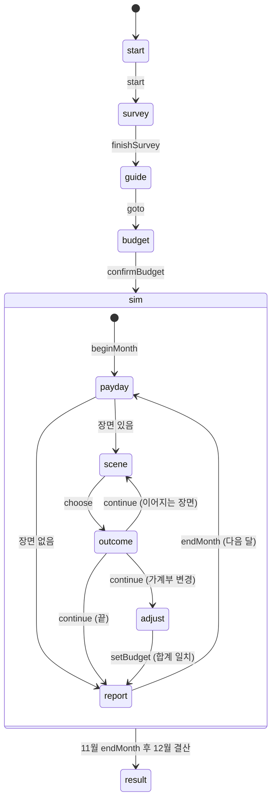

# 모듈 API 명세 (`packages/core`, `packages/draft-kit`)

- 작성일: 2026-10-26
- 대상: 화면 앱(`src`)과 이후 엔진 구현
- 규칙의 근거: `가계부-시나리오-수업-기획서.md` 4~6장

## 1. 저장소 구조

```
.
├── 가계부-시나리오-수업-기획서.md
├── docs/
│   ├── core-api.md          이 문서
│   ├── design-brief.md      디자인 시안 요구사항 (비교 단계 기록)
│   └── design-review.md     시안 비교 기록 (src1 '통장 정리' 채택)
├── packages/
│   ├── core/                화면과 무관한 순수 TypeScript (타입, 데이터, 계산, 엔진, 목업)
│   │   └── src/
│   │       ├── types.ts     모든 공용 타입
│   │       ├── format.ts    금액·날짜 표기
│   │       ├── selectors.ts 상태 → 화면용 값 계산
│   │       ├── engine.ts    상태 생성, 추천 가계부, step (미구현)
│   │       ├── fixtures.ts  목업 스냅숏 상태
│   │       └── data/        이벤트, 설문, 안내, 계좌, 상태, 도전과제, 엔딩, 프롬프트, 상수
│   └── draft-kit/           스냅숏 네비게이터 셸 (디자인 대상 아님)
├── src/                     화면 앱 (Vite + React + TypeScript + Tailwind CSS v4)
└── scripts/                 스크린숏, 단일 HTML 빌드, 정적 서버
```

명령

| 명령 | 내용 |
| --- | --- |
| `pnpm install` | 의존성 설치 |
| `pnpm dev` | 화면 앱 개발 서버 (Vite 기본 포트 5173) |
| `pnpm typecheck` | 전체 타입 검사 |
| `pnpm build` | 전체 빌드 |
| `pnpm shots [--only=id1,id2] [--viewports=laptop,tablet,tabletPortrait,phone]` | `shots/<스냅숏>--<화면크기>.png` 생성. 페이지 오류가 있으면 종료 코드 2 |

화면 앱은 `@gagyebu/core`와 `@gagyebu/draft-kit`을 소스 그대로 가져다 씁니다 (별도 빌드 없음). 모든 import는 패키지 루트에서 합니다.

```ts
import { FIXTURES, formatMan, budgetSummary, EVENTS, type GameState } from '@gagyebu/core';
import type { ScreenProps } from '@gagyebu/draft-kit';
```

## 2. 화면 앱과의 계약

### 2.1 화면 컴포넌트

각 화면 앱은 6개 화면 컴포넌트를 `ScreenMap`으로 넘깁니다. `src/src/App.tsx`에 이미 연결되어 있습니다.

```ts
type ScreenId = 'start' | 'survey' | 'guide' | 'budget' | 'sim' | 'result';

interface ScreenProps {
  state: GameState;     // 스냅숏의 상태 (복사본이라 화면 안에서 고쳐도 됨)
  ui: FixtureUi;        // GameState에 없는 화면 내부 상태 힌트
  fixture: Fixture;     // id, label, note
  go: (fixtureId: string) => void;      // 다른 스냅숏으로 이동
  goScreen: (screen: ScreenId) => void; // 그 화면의 첫 스냅숏으로 이동
}

interface FixtureUi {
  startStage?: 'name' | 'reveal';
  surveyIndex?: number;     // 0~6 질문, 7 결과
  guideIndex?: number;      // 0~5
  openChoiceId?: string;    // 지불·입금 패널이 열린 선택지
  presentation?: boolean;   // 결과 화면 발표용 크게 보기
}
```

- 주소는 `#/<스냅숏 id>`입니다. `?shot`을 붙이면 네비게이터가 숨겨집니다 (스크린숏용).
- 네비게이터: 오른쪽 아래 버튼, `` ` `` 키로 열고 닫기, `[` `]` 키로 이전/다음 스냅숏.
- 스냅숏이 바뀌면 화면 컴포넌트가 새로 마운트됩니다 (`key`가 스냅숏 id).

### 2.2 엔진 연결 전에 지킬 것

- `step()`은 아직 구현되지 않았고 호출하면 예외가 납니다. 화면은 `state`와 `ui`로 그립니다.
- 입력, 패널 열기, 금액 나누기 같은 화면 안의 상호작용은 컴포넌트 로컬 상태로 흉내 냅니다. 계산은 아래 선택자를 씁니다.
- 다음 단계로 넘어가는 버튼은 `go()`나 `goScreen()`으로 그럴듯한 다음 스냅숏에 연결합니다. 예: 설문 결과의 "다음" → `goScreen('guide')`, 2월 장면의 "수리한다" → 로컬로 지불 패널 열기, 확정 → `go('sim-feb-outcome')`.
- 금액은 직접 계산하지 말고 `selectors.ts`와 `format.ts`를 씁니다.

## 3. 타입 요약

전체 정의는 `packages/core/src/types.ts`에 있습니다. 화면에서 자주 쓰는 것만 정리합니다.

### 3.1 계좌와 가계부

| 타입 | 내용 |
| --- | --- |
| `AccountId` | `living` 생활비, `emergency` 비상금, `savings` 적금, `invest` 투자, `goal` 목표, `housing` 청약 |
| `TransferAccountId` | `living`을 뺀 자동이체 대상 5개 |
| `ExpenseId` | `rent` `phone` `insurance` `transport` `subscription` (고정비), `food` `household` `beauty` `leisure` `family` (변동비) |
| `Budget` | `{ transfers: Record<TransferAccountId, Won>, expenses: Record<ExpenseId, Won>, livingBuffer: Won }` |
| `BudgetSummary` | `budgetSummary()` 결과: 자동이체 합계, 지출 합계, 고정/변동 합계, 생활비 입금액, 남은 금액(0이어야 확정), 저축률, 계좌별 비율 |
| `BudgetIssue` | `over` 초과 / `under` 미달 / `negative` 음수 항목 |

생활비 통장 입금액 = 지출 예산 합계 + 여유분. 월급 = 자동이체 합계 + 생활비 입금액이어야 가계부를 확정할 수 있습니다.

### 3.2 게임 상태 `GameState`

| 필드 | 내용 |
| --- | --- |
| `phase` | `start` `survey` `guide` `budget` `sim` `result` |
| `profile` | 닉네임, 배정된 월급, 기준 월급 |
| `survey` | 답변, 결과(유형, 점수, 추천 가계부) |
| `initialBudget`, `budget` | 처음 확정한 가계부, 현재 가계부 |
| `month`, `step` | 현재 월(1~12)과 그 달 안의 단계 (아래 4.2) |
| `payday` | 이번 달 월급날 처리 내역: 자동이체, 생활비 입금·지출, 할부 상환, 이자·수익, 상태 효과, 생활비 부족분 |
| `accounts` | 계좌별 `{ balance, contributed, earned }` |
| `savings` | 적금 납입 횟수, 해지 여부 |
| `debts` | 할부·카드값·리볼빙 목록 (`remaining`, `monthly`, `monthsLeft`) |
| `statuses` | 지속 효과 (`STATUSES`에 정의). `note`에 "현재 시세 42만 원" 같은 문구 |
| `satisfaction` | 0~100, 시작 60 |
| `credit` | 0~1000, 시작 850 |
| `queue`, `current` | 이번 달에 남은 장면, 지금 장면 |
| `lastOutcome` | 마지막 선택의 결과 (피드백, 변화 목록, 이어지는 장면, 교훈, 가계부 조정 이유) |
| `scheduled` | 몇 달 뒤로 예약된 장면과 예고 문구 |
| `history` | 끝난 달마다 순자산, 계좌 잔고, 부채, 만족도, 신용점수 |
| `decisions` | 선택 기록 (월, 이벤트 코드, 선택지 이름, 지불 내역, 태그) |
| `budgetEdits` | 가계부를 조정한 횟수 |
| `unlocked` | 달성한 도전과제 |
| `settlement` | 12월 결산: 적금 만기(세전·세후), 최종 잔고, 순자산, 부채, 엔딩, 도전과제 목록, 가계부 전후 비교 |

### 3.3 이벤트 (로그라이크식 장면 그래프)

```ts
interface GameEvent {
  id: EventId; code: string; type: EventType; month: MonthNo;
  title: string; summary: string; lesson: string; promptId?: PromptId;
  entry: SceneId; entryVariants?: { when: Condition; scene: SceneId }[];
  scenes: Record<SceneId, Scene>;
}
interface Scene {
  id: SceneId;
  channel: 'narration' | 'messenger' | 'sms' | 'news' | 'app';
  speaker?: string; title?: string; text: string;
  reveal?: { label: string; value: string }[];   // 이 장면에서 공개되는 숫자
  choices: Choice[];
}
interface Choice {
  id: string; label: string; detail?: string;
  kind: 'pay' | 'fixedPay' | 'free' | 'deposit' | 'gamble' | 'budget';
  pay?: PaySpec; fixedPay?: FixedPaySpec; deposit?: DepositSpec;
  requires?: Condition; lockedReason?: string;
  effects?: Effect[]; next?: NextScene; feedback: string; tags?: ChoiceTag[];
}
```

| `Choice.kind` | 화면 동작 |
| --- | --- |
| `pay` | 지불 패널: `fundingOptions()`로 수단별 한도·경고를 받아 여러 계좌로 나눠 내기. 카드면 `cardMonths` 중 할부 개월 선택. `adjustable`이 있으면 금액도 고름. `to`가 있으면 지출이 아니라 계좌 이동 |
| `fixedPay` | 확인 단계: `fixedPay.label`(예: "12개월 무이자 할부, 매달 12.5만 원")을 보여 주고 확정 |
| `free` | 바로 결과 |
| `deposit` | 입금 패널: `resolveAmount()` 금액을 `targets` 중 한 계좌에 넣기 |
| `gamble` | 결과가 다음 장면이나 몇 달 뒤로 이어짐. `pay`가 함께 있으면 지불 패널 먼저 |
| `budget` | 결과 뒤 가계부 조정 단계로 (`openBudget` 효과의 `reason` 표시) |

`next.delayMonths`가 없으면 같은 달에 바로 다음 장면이 이어지고, 있으면 그 달로 예약됩니다. `next.when`은 예약된 달 월초에 다시 판정합니다.

중요: 선택지를 좋은 것과 나쁜 것으로 색칠하거나 순서로 암시하지 않습니다. 학생이 스스로 판단해야 합니다. 잠긴 선택지(`requires`)와 지불 수단 경고는 보여 줍니다.

## 4. 엔진 (`engine.ts`)

### 4.1 구현된 함수

| 함수 | 내용 |
| --- | --- |
| `rollSalary(random?, base?)` | 기준 월급 ±10%, 1만 원 단위 |
| `createInitialState(nickname, salary)` | 시작 상태 |
| `classifySpending(answers)` | 소비 성향 유형과 점수 |
| `recommendBudget(answers, salary)` | 추천 가계부가 담긴 `SurveyResult` |
| `emptyBudget()`, `emptyAccounts()` | 빈 값 |

### 4.2 `step(state, action)` (미구현, 이후 단계)

`useReducer(step, initial)`에 그대로 연결하는 순수 함수입니다. 구현 전까지는 호출하지 않습니다. 이후 구현할 상태 전이는 다음과 같습니다.



| Action | 내용 |
| --- | --- |
| `start { nickname }` | 월급 배정, `phase: 'survey'` |
| `answer { question, option }` | 설문 답 저장 |
| `finishSurvey` | 유형 판정과 추천 가계부를 `budget`에 채움 |
| `goto { phase }` | 이전/다음 화면 이동 (시뮬레이션 시작 후에는 뒤로 갈 수 없음) |
| `setBudget { budget }` | 가계부 수정. 조정 단계에서는 `budgetEdits` 증가 |
| `confirmBudget` | 합계가 월급과 같을 때만. `initialBudget` 고정, `phase: 'sim'` |
| `beginMonth` | 월급날 처리 → 예약 장면과 배치 이벤트를 `queue`에 넣음 |
| `choose { choiceId, payment?, depositTo?, amount? }` | 선택 처리, `lastOutcome` 생성 |
| `continue` | 다음 장면 / 가계부 조정 / 월말 리포트 |
| `statusAction { status, action, depositTo? }` | 상태 카드 행동 (운동화 팔기) |
| `endMonth` | `history`에 기록하고 다음 달. 11월 뒤에는 12월 결산 후 `phase: 'result'` |
| `reset` | 처음부터 |

월급날 처리 순서 (기획서 5.1~5.3): 월급 입금 → 자동이체 → 생활비 입금 → 지출(예산 + 할부·카드값·리볼빙 상환 + 물가 상승분) → 부족하면 카드값으로 넘기고 만족도 -5 → 비상금·목표·청약 이자, 투자 월 수익률 → 상태 효과(만족도).

## 5. 선택자와 표기 (`selectors.ts`, `format.ts`)

| 함수 | 반환 |
| --- | --- |
| `budgetSummary(budget, salary)` | `BudgetSummary` |
| `budgetIssues(budget, salary)` / `isBudgetValid(...)` | 문제 목록 / 확정 가능 여부 |
| `expenseTotal(budget)` / `transferTotal(budget)` | 합계 |
| `netWorth(state)` | 계좌 합 + 보유 운동화 시세 - 부채 |
| `totalDebt(state)` | 남은 부채 |
| `emergencyMonths(state)` | 비상금 ÷ 월 지출 예산 |
| `creditGrade(score)` | `{ tier: 1~5, label }` (매우 우수 ~ 위험) |
| `satisfactionBand(score)` | `{ level: 1~5, label }` (아주 만족 ~ 번아웃) |
| `savingsMaturity(monthly, months?, broken?)` | 적금 원금, 세전 이자, 세금, 세후 이자 |
| `sneakerValue(state, month?)` | 운동화 판매 시 받는 금액 (수수료 뺀 값) |
| `monthKind(month)` | `tutorial` `event` `quiet` `settlement` |
| `eventForMonth(month)` | 그 달에 배치된 이벤트 |
| `getScene(ref)` | `{ event, scene }` |
| `entrySceneId(state, event)` | 조건에 맞는 시작 장면 |
| `evalCondition(state, cond)` | 조건 판정 |
| `choiceAvailability(state, choice)` | `{ enabled, reason }` |
| `resolveAmount(state, spec)` | `AmountSpec`을 금액으로 |
| `fundingOptions(state, pay)` | 수단별 `{ source, max, warning }` (카드는 `max: null`) |
| `formatWon(n)` | `1,234,567원` |
| `formatMan(n)` | `123.5만 원`, `5천 원` |
| `formatSignedWon(n)` | `+50,000원` / `-230,000원` |
| `formatPct(r)` | `37.6%` |
| `monthLabel(m)` | `3월` |
| `fillTemplate(t, values)` | 프롬프트 `{key}` 채우기 |

## 6. 데이터 (`data/`)

| 이름 | 내용 |
| --- | --- |
| `ACCOUNTS`, `ACCOUNT_ORDER`, `TRANSFER_ORDER` | 계좌 6종: 이름, 상품 예시, 목적, 이율, 꺼내 쓸 때 규칙, 권장 배분 |
| `EXPENSES`, `EXPENSE_ORDER` | 지출 항목 10종: 이름, 고정/변동, 예시 |
| `SURVEY`, `SPENDING_TYPES` | 설문 7문항과 소비 성향 3유형 |
| `GUIDE_CARDS` | 재무 기초 안내 카드 6장 |
| `CLOSING_TIPS` | 결과 화면 하단 실행법과 마음가짐 |
| `EVENTS`, `SCHEDULE`, `EVENT_TYPE_LABEL` | 이벤트 9개(튜토리얼 포함)와 월별 배치 |
| `STATUSES` | 지속 효과 6종: 이름, 설명, 성격(buff/debuff/neutral), 매달 효과, 행동 |
| `ACHIEVEMENTS`, `ACHIEVEMENT_ORDER` | 도전과제 13개 (숨김 4개) |
| `ENDINGS`, `ENDING_ORDER`, `ENDING_THRESHOLDS` | 엔딩 칭호 5개와 임시 기준값 |
| `PROMPTS` | 단계별 AI 프롬프트 템플릿 |
| `BASE_SALARY`, `RATES`, `MARKET_RETURNS`, `SNEAKER_PRICES`, `RESELL_FEE`, `QUIET_MONTHS`, `SETTLEMENT_MONTH` | 가정값 |

AI 프롬프트 복사 예시:

```ts
const text = fillTemplate(PROMPTS.budget.template, {
  salary: formatWon(state.profile.salary).replace('원', ''),
  meal: '5천~1만 원',
  delivery: '1~2번',
});
await navigator.clipboard.writeText(text);
```

## 7. 목업 스냅숏 (`FIXTURES`)

등장인물 두 명의 1년을 근사 계산해 만든 스냅숏입니다. 숫자는 기획서 규칙을 단순화한 근사값입니다.

- 하늘 (월급 263만 원, 균형형): 신중하게 고르는 경로. 비상금과 목표 통장으로 수리, 협상 성공, 급락에도 유지, 사기 모두 회피 → "균형 잡힌 재무설계자"
- 바다 (월급 241만 원, 즉흥형): 새 노트북 할부, 운동화 리셀, 가족 사칭 피해, 복권 재도전, 급락에 전부 매도, 물가 무시 → 리볼빙 → "빚과의 동거"

| id | 화면 | 이름 | 꼭 보여야 하는 것 |
| --- | --- | --- | --- |
| `start-name` | start | 닉네임 입력 | 수업 첫 화면. "여러분은 오늘 첫 월급을 받았습니다" 상황 제시 |
| `start-reveal` | start | 월급 공개 | "축하합니다! 하늘님의 첫 월급은 2,630,000원입니다" 연출 |
| `survey-q1` | survey | 설문 1번 | 한 화면에 질문 하나. 진행 표시(1/7) |
| `survey-q7` | survey | 설문 7번 | 마지막 질문 (소비 성향 질문) |
| `survey-result` | survey | 소비 성향 결과 | 유형(균형형) + 한 줄 피드백 + 추천 가계부 미리보기 |
| `guide-1` | guide | 안내 카드 1 | 카드 6장 중 첫 장 |
| `guide-3` | guide | 안내 카드 3 (통장 쪼개기) | 계좌 6종 소개가 들어가는 가장 정보가 많은 카드 |
| `budget-ok` | budget | 추천 가계부 (합계 일치) | 합계 = 월급. 다음 단계 버튼 활성 |
| `budget-over` | budget | 가계부 초과 | 자동이체를 늘려 12만 원 초과. 경고와 비활성 버튼 |
| `sim-jan-payday` | sim | 1월 월급날 (튜토리얼) | 월급 입금 → 자동이체 → 생활비 사용 → 이자 순서 연출. 계좌 카드 숫자 증가 |
| `sim-feb-scene` | sim | 2월 노트북 고장 | 장면 카드 + 선택지 4개 (지불형, 연쇄, 고정 지불형, 무지출형). 비상금 약 52만 원 < 수리비 60만 원 |
| `sim-feb-pay` | sim | 2월 지불 수단 고르기 | 수리 60만 원을 계좌별로 나눠 내기. 비상금(약 52만 원)만으로는 부족, 적금·청약·투자 경고, 카드 일시불/3개월 |
| `sim-feb-seller` | sim | 2월 중고거래 판매자 (메신저) | 채널이 messenger인 장면. 사기 반전 |
| `sim-feb-outcome` | sim | 2월 결과 피드백 | 잔고 변화(비상금 약 -52만, 목표 약 -8만), 교훈 한 줄 |
| `sim-mar-resell` | sim | 3월 운동화 리셀 (도박형) | 친구 메신저 + 공개 정보(발매가, 리셀가) |
| `sim-apr-check` | sim | 4월 리셀 시세 알림 (예약 후속) | 이벤트 없는 달에 예약 장면 등장. 상태 "운동화 보유", "노트북 할부" 표시 |
| `sim-may-message` | sim | 5월 가족 사칭 메시지 (연쇄 장면) | 같은 달 두 번째 장면. 모르는 번호 메신저 |
| `sim-jun-adjust` | sim | 6월 가계부 조정 (월세 +5만) | 가계부 변경형 선택 뒤 조정 단계. 5만 원 초과 상태에서 다른 항목을 줄여야 함 |
| `sim-jul-reveal` | sim | 7월 복권 10장 결과 (기대값 공개) | 공개 정보(reveal) 강조. 그만둔다(입금형) / 한 장 더(도박형) |
| `sim-aug-crash` | sim | 8월 증시 급락 (뉴스) | 뉴스 속보 채널. 투자 계좌 -15% 반영. 선택지 4개 |
| `sim-aug-deposit` | sim | 8월 전부 매도 후 입금 계좌 고르기 | 입금형 패널: 판 돈을 넣을 계좌 선택. 손실 확정 금액 표시 |
| `sim-oct-report` | sim | 10월 월말 리포트 (이벤트 없는 달) | 이벤트 없는 달의 월말 리포트. 생활비 부족, 상태(리볼빙, 노트북 할부, 운동화), 신용점수 하락 |
| `sim-nov-invite` | sim | 11월 코인 리딩방 초대 | 조건부 선택지(적금 300만 원 이상). 하늘은 열림 |
| `sim-nov-locked` | sim | 11월 코인 리딩방 (잠긴 선택지) | 적금이 300만 원보다 적어 첫 선택지가 잠김. 잠긴 이유 표시 |
| `result-balanced` | result | 결과: 균형 잡힌 재무설계자 | 적금 만기 연출, 순자산 그래프, 도전과제 8/13, 숨은 도전과제 |
| `result-debt` | result | 결과: 빚과의 동거 | 부채가 남은 엔딩. 놓친 도전과제가 많음 |
| `result-present` | result | 결과: 발표용 크게 보기 | 교실 프로젝터용. 멀리서도 읽히는 크기 |

## 8. core에 고칠 점이 보이면

화면 작업 중 데이터나 타입이 부족하면 `packages/core`를 직접 고치지 말고, `src/DESIGN.md`의 "core에 대한 제안" 절에 적습니다. 지금까지 모은 제안은 `docs/design-review.md` 4장에 정리되어 있습니다.
