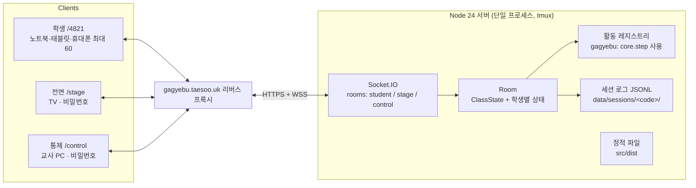

# 중앙 통제식 수업 모드 계획 (학생 · 전면 TV · 통제 페이지)

- 작성일: 2026-11-08 (v2: 사용자 결정 반영)
- 상태: 구현됨 (M1–M8, 브랜치 feat/live-classroom). M0 기기 확인·M9 리허설은 남음 (§11 진행 메모)
- 관련 문서: `가계부-시나리오-수업-기획서.md`, `docs/core-api.md`, `docs/live-api.md`(구현 계약·§14 결정 기록), `src/DESIGN.md`

## 0. 요약

지금 앱은 학생 한 명이 자기 속도로 넘기는 단일 페이지입니다. 이것을 **교사가 통제 페이지에서 넘기면 반 전체가 항상 같은 단계에 있는** 수업 모드로 바꿉니다.

| 페이지 | 주소(안) | 기기 | 역할 |
| --- | --- | --- | --- |
| 학생 | `/<수업 코드>` (예: `/4821`) | 학생 기기 (대부분 노트북, 태블릿·휴대폰도 지원). 메신저로 링크 배포 | 슬라이드 보기, 게임 조작, 끝나면 대기 |
| 전면 | `/stage` (**전면 비밀번호**) | 교실 TV (교사 PC 확장 화면) | 슬라이드, 장면 크게 보기, 게임 선택 분포, 발표 |
| 통제 | `/control` (**통제 비밀번호**) | 교사 PC | 수업 열기·끝내기, 다음/이전, 결과 공개, 완료 인원 확인, 발표자 지정 |

주소 구성은 8장 8번, 비밀번호는 7.1장.

### 확정된 결정

| 항목 | 결정 |
| --- | --- |
| 동기화 | **항상 강제 동기화.** 교사가 넘기면 모든 학생이 그 단계로 이동. 끝내지 못한 학생은 기본 선택지로 자동 처리 |
| 선택 실패 시 | 장면마다 **대놓고 나빠 보이는 선택지**를 기본값으로 지정 (학생도 직접 고를 수 있음). 장면별 목록은 부록 A |
| 가계부 기본값 | **편집 중이던 안**을 그대로 쓰고, 남는 돈은 생활비 통장 여유분에 넣고, 모자라는 돈은 여유분에서 뺌 (2.3장). 가계부 조정 단계도 같은 규칙 |
| 설문 기본값 | 답하지 않은 문항은 **중간 답** |
| 미완료 확인 | 미완료 학생이 있을 때 "다음"을 누르면 **확인 대화상자** |
| 타이머 | **카운트다운 없음.** 대신 통제 페이지에 완료 인원(예: 47/58)과 미완료 명단 표시 |
| 슬라이드 | 나중에 추가. **웹 형식(React)**. 학생 화면과 전면 화면에 그대로 띄움. 두 화면에는 버튼 등 조작 요소를 두지 않음 |
| 설문 | **한 화면에 7문항 모두.** 설문 문항 분포는 어디에도 보이지 않음 |
| 공개 범위 | 개인정보가 없는 **게임 안의 선택**(사건 선택지, 가계부 배분, 순자산, 엔딩, 도전과제)은 익명 집계로 TV에 보여 줌 |
| 닉네임 | TV에는 **입장 화면과 발표자 지정 때만** 보임. 통계는 모두 익명 |
| 호스팅 | **지금 서버 + 리버스 프록시(gagyebu.taesoo.uk)** |
| 학생 주소 | **`/<숫자 4자리 수업 코드>`.** `/`는 코드 입력 화면. 끝난 수업의 링크는 막힘 |
| 접근 제한 | **전면과 통제에 각각 다른 비밀번호.** `.env`에 둠 (git 관리 밖) |
| 규모·기기 | **최대 60명.** 노트북 우선, 태블릿·휴대폰에서도 모든 단계를 할 수 있어야 함 |
| 서버 | Node 24 + Socket.IO, 정적 파일도 같은 프로세스. 서버가 상태를 관리 (`packages/core`를 빌드 없이 import 가능함을 확인) |
| 모듈 경계 | **레슨 스크립트(데이터) / 활동 모듈(규칙+3화면) / 플랫폼(서버·통신·통제)** 3층. 실습 내용과 양식이 바뀌어도 플랫폼은 그대로 |

선결 조건: **시뮬레이션 엔진 `step()`이 아직 없습니다.** 1~11월 시뮬레이션은 엔진이 있어야 중앙 통제가 됩니다. 시작·설문·안내·가계부는 이미 있는 함수(`rollSalary`, `createInitialState`, `recommendBudget`, `isBudgetValid`)로 만들 수 있으므로 플랫폼 작업과 엔진 작업을 나란히 진행합니다.

---

## 1. 현재 코드 진단

| 관찰 | 위치 | 계획에 주는 의미 |
| --- | --- | --- |
| 화면은 목업 스냅숏 27개와 컴포넌트 로컬 상태로만 그림. 주소 해시 = 스냅숏 id | `packages/draft-kit`, `packages/core/src/fixtures.ts` | 실제 진행 상태가 없음. 서버가 진행을 쥐려면 엔진이 필요 |
| 다음 단계 이동이 `go(fixtureId)` / `goScreen()`과 이동표 | `src/src/components/sim/routes.ts`, 각 Screen | 이 콜백을 `dispatch(action)`으로 바꾸는 것이 화면 쪽 주 작업. DESIGN.md 6장도 "콜백만 연결하면 되게" 해 둠 |
| 화면마다 이전/다음 버튼이 있음 (설문, 안내 카드, 가계부) | `SurveyScreen`, `GuideScreen`, `BudgetScreen` | 강제 동기화에서는 학생이 단계를 넘기지 않음. 수업 모드에서는 이동 버튼을 숨기고 "제출"만 남김 |
| `step()`은 시그니처만 있고 예외를 던짐 | `packages/core/src/engine.ts` | M1에서 구현. 서버가 이 함수로 학생 행동을 처리 |
| `Action` 타입과 상태 전이 표가 이미 정의됨 | `types.ts`, `core-api.md` 4.2 | 프로토콜은 이 `Action`을 그대로 실어 나름 |
| 랜덤은 월급 하나, 이벤트·수익률·결과는 고정 | 기획서 5.1 | 서버가 월급만 정해 행동에 넣으면 전 과정이 결정적 → 로그 재생으로 복원 가능 |
| `core`는 순수 TS, `.ts` 확장자 import | `packages/core` | Node 24에서 `import('./packages/core/src/index.ts')` 동작 확인. 서버에 빌드 단계 불필요 |
| 화면은 노트북·태블릿 우선. 휴대폰 지불 패널이 길다는 문제 기록 | `src/DESIGN.md` 6장 | 노트북이 주 기기라 큰 개편은 필요 없지만, 휴대폰에서도 끝까지 할 수 있게 지불 패널·기둥 패널을 정리 |
| 발표용 크게 보기, 장면 카드, 순자산 그래프, 비율 막대 등 재사용 가능한 부품 | `ResultPresentation.tsx`, `components/` | 전면 TV 화면 대부분을 재사용으로 그림 |
| 안내 카드 6장 | `GuideScreen.tsx`, `data/guide.ts` | 수업 모드에서는 표시 전용 단계(버튼 없음)로 바꿈 |
| 정적 서버가 모든 파일에 `cache-control: no-store` | `scripts/serve.mjs` | 60대가 같은 와이파이로 받으므로 해시 붙은 `assets/`는 오래 캐시(`immutable`)로 바꿈. 빌드 결과 12MB 대부분은 unicode-range로 쪼갠 폰트 조각이라 실제로 받는 양은 그보다 훨씬 적음 |
| `vite.config.ts`의 `base: './'` | `src/vite.config.ts` | `/4821`, `/stage`, `/control` 경로를 쓰려면 앱은 `base: '/'`. 단일 HTML 빌드는 자기 설정 유지 |
| 정적 서버가 없는 경로를 모두 `index.html`로 돌려줌 | `scripts/serve.mjs` | 새 서버는 알려진 경로(`/`, `/<4자리>`, `/stage`, `/control`, `/dev`, `/solo`)만 앱으로 보내고 나머지는 404. `/contorl` 같은 오타가 학생 화면이 되지 않게 |

---

## 2. 진행 모델: 강제 동기화

### 2.1 용어

- **레슨(Lesson)**: 한 수업의 전체 순서. 세그먼트의 목록.
- **세그먼트(Segment)**: 슬라이드 덱 하나, 또는 활동(가계부 게임) 하나.
- **비트(Beat)**: 교사가 "다음"을 눌러 넘기는 한 칸. 세그먼트가 자기 비트 목록을 만듦.
- **커서(Cursor)**: 지금 모두가 있는 비트 `{ segment, beat, revealed }`.

| 비트 종류 | 학생 화면 | 예 |
| --- | --- | --- |
| `show` 표시형 | 모두 같은 내용. 조작 요소 없음 | 슬라이드, 안내 카드, 결과 공개 |
| `work` 작업형 | 각자 조작하고 제출. 제출 뒤에는 대기 화면 | 닉네임, 설문, 가계부, N월 사건 |

작업형 비트에는 **공개(reveal) 토글**을 붙일 수 있습니다. 응답하는 동안 TV에는 장면만, 교사가 공개하면 선택 분포와 교훈이 나옵니다(Kahoot식). 공개는 같은 비트 안의 토글이라 교사의 "다음" 키 하나가 `공개 → 다음 비트` 순서로 동작합니다.

### 2.2 규칙

1. **학생은 단계를 넘길 수 없습니다.** 학생 화면에는 단계 이동 버튼이 없습니다. 제출하면 대기 화면이 됩니다.
2. **교사가 "다음"을 누르면 서버가 한 번에 처리합니다.**
   1. 현재 비트를 마감합니다. 이후 도착한 학생 행동은 "이미 다음 단계로 넘어갔어요"로 거부합니다.
   2. 아직 끝내지 않은 학생마다 그 학생이 서 있는 지점의 **기본값**을 적용합니다. 그 비트가 끝날 때까지 반복합니다. 예: 2월에 "중고를 알아본다"를 고르고 판매자 장면에서 멈춘 학생은 판매자 장면의 기본 선택지가 적용됩니다.
   3. 학생이 고를 것이 없는 전이(`endMonth`, `beginMonth`, `finishSurvey`)를 실행합니다.
   4. 커서를 옮기고 모두에게 알립니다.
3. **자동 처리된 학생에게는 알립니다.** 학생 화면의 결과 단계에 "시간 안에 고르지 못해 '○○'이(가) 자동으로 선택됐어요"라고 보이고, 기록(`decisions`)에도 자동 처리 표시가 남습니다. 결과 화면 선택 기록에서도 구분됩니다.
4. **교사는 다음 키를 누르기 전에 통제 페이지에서 완료 인원을 봅니다.** 카운트다운은 없습니다. 미완료가 남아 있을 때 다음을 누르면 "3명이 아직 고르는 중입니다. 기본 선택지로 넘길까요?" 확인 대화상자가 뜹니다(설정으로 끌 수 있음).
5. **뒤로**는 표시형 비트(슬라이드, 안내 카드, 공개 화면)를 다시 보여 주는 데만 씁니다. 학생의 게임 상태는 절대 되감지 않습니다. 작업형 비트로는 뒤로 갈 수 없습니다.
6. **지각 입장.** 수업 중간에 들어온 학생은 닉네임을 입력하면 지나간 작업형 비트를 모두 기본값으로 채운 뒤 현재 비트에 합류합니다. 결과는 공정하지 않지만 반 전체 흐름은 유지됩니다. 통제 페이지에 "지각 합류"로 표시됩니다.
7. **연결이 끊긴 학생**도 서버에는 상태가 있으므로 똑같이 자동 처리되고, 다시 연결되면 현재 비트로 바로 들어옵니다.

### 2.3 기본값 (선택 실패 시)

| 결정 지점 | 기본값 | 비고 |
| --- | --- | --- |
| 사건 장면 (같은 달 이어지는 장면 포함) | 장면마다 하나인 **대놓고 나빠 보이는 선택지** (`fallback: true`). 이미 그런 선택지가 있으면 그것을 지정하고, 없으면 새로 넣음. 목록은 부록 A | 잠김 조건(`requires`)이 없어 누구나 고를 수 있어야 함. 학생도 직접 고를 수 있음 |
| 기본 선택지가 지불형(`pay`)일 때 | **자동 지불 계획**: 허용된 수단 중 생활비 → 비상금 → 목표 → 투자 → 적금 → 청약 순서로 잔고만큼, 남으면 카드 일시불(허용될 때), 그래도 남으면 생활비 부족분 규칙(다음 달 카드값, 만족도 -5) | 금액을 고를 수 있는 선택지(`adjustable`)는 최솟값 |
| 기본 선택지가 입금형(`deposit`)일 때 | 데이터의 첫 번째 입금 계좌 | |
| 지불·입금 패널 작성 중 | 패널 내용은 제출 전이라 서버가 모름 → 그 장면의 기본 선택지 | |
| 결과 화면(`outcome`)에 멈춤 | `continue` | 고를 것이 없음 |
| **가계부 작성** | **편집 중이던 안**을 쓰고 아래 "합계 맞추기"로 월급과 맞춤. 편집을 한 번도 안 했으면 처음 값(추천 가계부) | 편집 중인 안은 1~2초 간격으로 묶어 서버에 보냄 (집계에는 쓰지 않음) |
| **가계부 조정** (6월 월세, 9월 물가, 8월 투자 재설정) | 같은 규칙. 편집 중이던 안이 없으면 이벤트가 바꾼 가계부 그대로에서 합계 맞추기 | |
| 설문 | 답하지 않은 문항은 **중간 답** (보기 n개 중 `floor((n-1)/2)`번째, 데이터 순서) | 이미 답한 문항은 그대로 |
| 닉네임 | 입장 단계가 지나면 지각 입장 규칙으로 | - |

**합계 맞추기 (`balanceBudget`).** 기본 통장은 생활비 통장으로 봅니다.

1. 남는 돈(월급 - 자동이체 - 생활비 입금 > 0)은 생활비 통장 **여유분(`livingBuffer`)에 더합니다.**
2. 모자라는 돈은 **여유분에서 뺍니다.**
3. 여유분이 0이 되어도 모자라면, 생활비 통장에서 나가는 변동비를 여가 → 의류·미용 → 생활용품 → 경조사 → 식비 순서로 줄입니다. (여유분만으로 못 맞출 때를 위한 보완 규칙. 고정비와 자동이체는 건드리지 않습니다)
4. 결과는 항상 `isBudgetValid`를 통과합니다. 학생 화면에는 "제출하지 않아 남는 돈 3만 원이 생활비 여유분으로 들어갔어요"처럼 무엇이 바뀌었는지 보여 줍니다.

**교육용 원칙과의 관계.** 지금 원칙은 "선택지에 정답 힌트(색, 순서, 크기)를 주지 않는다"입니다. 나빠 보이는 선택지를 넣어도 그 원칙은 지킵니다. 생김새는 다른 선택지와 똑같이 `kind`로만 정하고, 위치는 데이터 순서를 따르며 맨 아래 같은 고정 자리를 두지 않습니다. 이 선택지가 기본값이라는 사실은 학생 화면에 표시하지 않습니다. 다만 명백히 나쁜 선택지가 나머지 선택지를 고르기 쉽게 만드는지는 리허설에서 확인합니다. 이 변경은 `AGENTS.md`의 교육용 원칙 문장에도 반영해야 합니다.

### 2.4 화면이 결정되는 방식

```
학생 화면 = 커서 비트의 Audience 화면 (내가 제출을 마쳤으면 대기 화면)
TV 화면   = 커서 비트의 Stage 화면 (+ revealed, 집계, 발표자)
통제 화면 = 타임라인 + 커서 + 완료 인원·미완료 명단 + 비트별 통제 패널
```

---

## 3. 비트별 세 화면 (가계부 게임 기본 레슨)

시뮬레이션은 한 달을 한 비트로 둡니다. 학생은 한 비트 안에서 월급날 연출 → 장면 → 선택·지불 → 결과 → (가계부 조정) → 월말 리포트까지 이어서 하고, 리포트에서 대기합니다. 1년을 교사 클릭 20번 안팎으로 진행합니다.

| 비트 | 종류 | 학생 | 전면 TV | 통제 |
| --- | --- | --- | --- | --- |
| (앞) 슬라이드 | show | 슬라이드만 | 슬라이드만 | 현재·다음 슬라이드 미리보기, 발표자 노트 |
| 입장 | work | 닉네임 입력 | QR + `gagyebu.taesoo.uk/4821`, 입장 인원, 닉네임 벽 | 학생 링크 복사, 인원, 이름 변경·내보내기, 입장 마감 |
| 월급 공개 | show | 내 월급 연출 | 모두의 첫 월급 265만 원 (2026-11-11: 분포 띠 삭제, live-api #166) | |
| 소비습관 설문 | work | **7문항 한 화면**, 제출 | "설문 중" 안내만 (분포 없음) | 완료 인원, 미완료 명단 |
| 설문 결과 | show | 내 유형, 추천 가계부 | 결과를 보는 방법 안내만 (유형 분포 없음) | |
| 안내 카드 1~6 | show | 카드 (버튼 없음) | 카드 크게 | 발표자 노트 |
| 가계부 작성 | work+reveal | 편집 → 제출 → 대기 | 작성 중 안내 → 공개 시 평균 저축률, 계좌별 배분 분포 | 완료 인원, 미완료 명단 |
| 1월 (튜토리얼) | work | 월급날 연출 → 리포트 | 월급날 흐름 도해 | 완료 인원 |
| 2·3·5·6·7·8·9·11월 | work+reveal | 월급날 → 장면 → 선택 → 결과 → (조정) → 리포트 | 첫 장면 크게 + 선택지(읽기 전용, 중립) → 공개 시 선택 분포, 이어진 장면 분포, 교훈 | 완료 인원, 이어지는 장면에 있는 학생 수 |
| 4·10월 (조용한 달) | work | 월급날 → (예약 장면이 있으면 그 장면) → 리포트 | "돈이 쌓이는 달", 반 순자산 분포 변화 | 완료 인원 |
| 12월 결산 | work+reveal | 결과 화면 | 공개 시 엔딩 분포, 도전과제 달성률 | |
| 발표 | show | 내 결과 | 지정한 학생의 발표용 크게 보기 (`PresentationView`, 닉네임 표시) | 학생 고르기, 다음 발표자 |
| (뒤) 정리 슬라이드 | show | 슬라이드만 | 슬라이드만 | 노트 |

TV 집계의 원칙

- 선택 분포 막대는 **모두 같은 색, 데이터 순서 그대로**. 많이 고른 쪽을 강조하거나 정렬하지 않습니다. 자동 처리된 응답은 따로 "자동 처리 N명"으로 셉니다.
- 순위·점수판은 두지 않고 분포(점 그림)만 보여 줍니다.
- 설문 답과 소비 성향은 개인 성향 정보이므로 TV에 보이지 않습니다.
- 응답 중 완료 인원은 TV에 보이지 않고 통제 페이지에만 보입니다. 필요하면 레슨 설정으로 켭니다.

---

## 4. 아키텍처



- **서버가 상태를 관리합니다.** 학생은 행동(`Action`)만 보내고, 서버가 `allowed → apply(step) → 저장 → 응답` 순서로 처리합니다. 낙관적 업데이트는 하지 않습니다.
- **로컬에 남는 것.** 지불 패널의 금액 나누기처럼 확정 전 조작은 지금처럼 컴포넌트 로컬 상태입니다. 예외는 가계부 초안으로, 자동 처리 때 쓰려고 편집 중 값을 1~2초 간격으로 묶어 보냅니다.
- **집계 전송.** 학생 행동이 들어오면 TV·통제용 집계를 다시 계산하되 초당 최대 4회로 묶습니다. 60명이면 부하는 무시할 수준입니다.
- **Socket.IO를 쓰는 이유.** 노트북 덮개를 닫거나 휴대폰 화면이 꺼지면 연결이 끊기는데, 자동 재접속이 내장되어 있습니다. 프록시나 학교망이 WebSocket을 막으면 롱폴링으로 바뀝니다.
- **개발 환경.** Vite 개발 서버의 `server.proxy`로 `/socket.io`를 게임 서버 포트로 넘깁니다(`ws: true`). 배포에서는 서버 하나가 `dist`와 소켓을 함께 맡고, `scripts/serve.mjs`의 역할을 흡수합니다.

---

## 5. 모듈 구조

### 5.1 폴더

```
master/
  packages/
    core/               (기존) 게임 규칙·데이터. + step() 구현. 수업 모드를 모름
    live/               NEW 플랫폼 공용: 레슨·비트·커서 타입, 프로토콜, ActivityLogic 인터페이스, 슬라이드 세그먼트 로직 (React 없음)
    activity-gagyebu/   NEW 가계부 활동의 순수 로직: 비트 생성, 진행 판정, 기본값 적용, 집계 (core + live에 의존)
    draft-kit/          (기존) 스냅숏 셸. /dev 경로로 유지 → pnpm shots 계속 동작
  server/               NEW Node 서버: Socket.IO, Room, 세션 로그, 비밀번호 로그인, 정적 파일
  lesson/               NEW 수업 콘텐츠
    lesson.ts           세그먼트 순서와 설정
    slides/             웹 슬라이드 (React 컴포넌트, 나중에 추가)
  src/                  (기존) 화면 앱
    src/
      live/             NEW 연결 훅(useLive), 역할 셸(Audience/Stage/Control), 대기 화면, 연결 표시
      activities/
        gagyebu/        NEW 활동의 세 화면: Audience(기존 screens 재사용), Stage, ControlPanel
        slides/         NEW 슬라이드 표시기 (학생·TV 공용, 버튼 없음) + 통제용 미리보기
        registry.ts     활동 id → 화면
      screens/, components/   (기존) 콜백만 dispatch로 바뀜
```

`pnpm-workspace.yaml`에 `server`, `lesson`을 추가합니다.

### 5.2 세 층의 경계

| 층 | 바뀌는 것 | 바꾸는 곳 | 건드리지 않는 곳 |
| --- | --- | --- | --- |
| 레슨 스크립트 | 수업 순서, 슬라이드 위치, 공개 단계 유무, 확인 대화상자 | `lesson/lesson.ts` | 서버, 화면 |
| 활동 모듈 | 실습의 규칙·내용·양식 (이벤트, 설문, 기본값, 화면) | `packages/core/data`, `packages/activity-gagyebu`, `src/activities/gagyebu` | 서버, 통제 페이지 |
| 플랫폼 | 통신, 커서, 재접속, 통제 UI | `packages/live`, `server`, `src/live` | 게임 규칙 |

다른 실습을 추가하려면 `ActivityLogic`과 세 화면을 구현해 레지스트리에 등록하고, 레슨 스크립트에 세그먼트를 넣습니다.

### 5.3 레슨 스크립트 예

```ts
// lesson/lesson.ts
export const lesson: Lesson = {
  id: 'first-salary',
  title: '내 첫 월급, 1년 살아 보기',
  segments: [
    { kind: 'slides', id: 'intro', deck: introDeck },          // 나중에 추가할 앞 발표 자료
    {
      kind: 'activity',
      id: 'game',
      activity: 'gagyebu',
      config: { guide: true, monthReveal: true, spotlight: true, confirmForce: true },
    },
    { kind: 'slides', id: 'wrap-up', deck: wrapUpDeck },       // 선택
  ],
};
```

### 5.4 핵심 타입 (안)

```ts
// packages/live
export interface Beat {
  id: string;              // 'survey', 'guide-3', 'm2'
  label: string;           // 통제 타임라인 표시
  mode: 'show' | 'work';
  reveal?: boolean;        // 공개 토글이 있는 비트
  notes?: string;          // 발표자 노트 (통제 페이지에만)
}

export interface Cursor { segment: number; beat: number; revealed: boolean }

export interface ClassState {
  code: string;             // 수업 코드 (숫자 4자리, 학생 주소 /<code>)
  version: number;          // 변경마다 +1
  cursor: Cursor;
  spotlight: string | null; // 발표자 studentId
  joinLocked: boolean;
}

export interface ActivityLogic<Cfg, S, A, Stats> {
  id: string;
  beats(cfg: Cfg): Beat[];
  init(ctx: { nickname: string; random: () => number }, cfg: Cfg): { state: S; actions: A[] };
  /** 이 비트에서 이 행동을 받을 수 있는지 */
  allowed(s: S, beat: number, a: A): true | string;
  apply(s: S, a: A): S;                              // gagyebu: core.step
  /** 이 비트에서 학생이 할 일을 다 했는지 */
  done(s: S, beat: number, cfg: Cfg): boolean;
  /** 끝내지 못한 학생에게 적용할 다음 기본 행동. done이 될 때까지 반복 호출 */
  fallback(s: S, beat: number, cfg: Cfg, draft?: unknown): A;
  /** 비트를 떠날 때 서버가 대신 실행하는 전이 (endMonth, beginMonth, finishSurvey) */
  transition(s: S, from: number, to: number, cfg: Cfg): A[];
  stats(all: S[], beat: number, cfg: Cfg): Stats;    // 익명 집계 (TV·통제용)
}

// src/activities
export interface ActivityViews<Cfg, S, A, Stats> {
  Audience: FC<{ state: S; beat: Beat; revealed: boolean; dispatch(a: A): Promise<void>; draft(d: unknown): void; submitted: boolean }>;
  Stage: FC<{ beat: Beat; revealed: boolean; stats: Stats; spotlight: S | null }>;
  ControlPanel?: FC<{ beat: Beat; revealed: boolean; stats: Stats; roster: RosterEntry[] }>;
}
```

슬라이드 세그먼트도 같은 인터페이스를 구현합니다. 학생 상태가 없고 모든 비트가 `show`입니다.

### 5.5 가계부 활동의 `done` 판정 (예)

| 비트 | done 조건 |
| --- | --- |
| 입장 | 닉네임 입력 |
| 설문 | 7문항 제출 |
| 가계부 작성 | `confirmBudget` 완료 (`phase: 'sim'`) |
| N월 | `month === N`이고 `step === 'report'` |
| 12월 결산 | `phase: 'result'` |

---

## 6. 프로토콜 (안)

모든 메시지는 `packages/live/src/protocol.ts`의 판별 유니언 하나로 정의하고 서버·클라이언트가 같은 타입을 씁니다.

학생 → 서버

| 메시지 | 내용 |
| --- | --- |
| `hello { role: 'student', code, token? }` | `code`는 주소(`/4821`)에서 읽음. 진행 중인 수업이 아니면 `ended`/`notFound`로 응답하고 클라이언트는 그 코드의 토큰을 지움. 토큰이 있으면 기존 학생으로 재접속 |
| `join { nickname }` | 새 학생. 서버가 토큰 발급 (localStorage에 수업 코드별로 저장) |

전면·통제는 소켓 연결 때 로그인 쿠키로 역할을 확인합니다(7.1장). 쿠키가 없거나 맞지 않으면 연결을 끊습니다.
| `act { seq, beat, action }` | 게임 행동. `beat`가 현재 비트와 다르면 거부. ack로 `{ ok, state }` 또는 `{ ok: false, reason }` |
| `draft { beat, data }` | 가계부 초안 (자동 처리용, 묶어서 전송) |

통제 → 서버 (통제 로그인 쿠키 필요)

| 명령 | 내용 |
| --- | --- |
| `next` | 공개 단계가 있고 아직 공개 전이면 공개. 아니면 마감 → 기본값 처리 → 전이 → 커서 이동 |
| `prev` / `goto { segment, beat }` | 표시형 비트로만. 상태는 되감지 않음 |
| `reveal { on }` | 공개 토글 |
| `spotlight { studentId \| null }` | TV 발표자 |
| `student { id, op: 'rename' \| 'kick' \| 'mergeInto' }` | 학생 관리 |
| `openClass { lesson }` / `endClass` | 새 수업 열기(서버가 4자리 코드 발급) / 수업 끝내기. 끝난 수업의 학생 링크는 막힘 (확인 필요) |
| `lockJoin { on }` | 입장 마감 |

서버 → 클라이언트

| 메시지 | 받는 쪽 | 내용 |
| --- | --- | --- |
| `snapshot { class, lesson, you?, state? }` | 접속 직후 전부 | 재접속 시에도 전체 상태 |
| `class { ClassState }` | 전부 | 커서·공개·발표자 변경 |
| `state { GameState, version, autoApplied? }` | 해당 학생 | 자동 처리·전이 뒤에도 전송. `autoApplied`로 "자동 선택됨" 안내 |
| `stats { beat, stats }` | stage, control | 묶어서 초당 최대 4회 |
| `roster { entries }` | control | 이름, 연결 여부, 현재 비트 완료 여부, 기기 종류 |
| `spotlightState { GameState }` | stage | 발표자 상태 |

재접속

- 끊기면 학생 화면 상단에 "다시 연결 중" 띠를 보이고, 자동 재접속 후 `snapshot`으로 복구합니다. 학생 화면은 Screen Wake Lock API로 화면 꺼짐을 막습니다(지원하는 브라우저에서).
- 토큰을 잃은 학생(브라우저를 바꾼 경우)이 같은 닉네임으로 들어오면 통제 페이지에 "기존 기록 이어받기" 승인 버튼이 뜹니다.

---

## 7. 서버 상세

- **Room 하나 = 수업 하나.** 교사가 통제 페이지에서 수업을 열면 서버가 숫자 4자리 코드를 발급합니다. 학생 주소는 `/<코드>`입니다. 기본은 한 번에 수업 하나이고, 필요하면 리허설용 수업을 따로 열 수 있습니다.
- **수업 코드.** 진행 중이거나 최근에 끝난 수업과 겹치지 않게 무작위로 고릅니다. 숫자만 쓰므로 TV에서 읽어 주기 쉽고 `stage`·`solo` 같은 경로와 겹치지 않습니다. 끝난 수업의 코드로 들어오면 "끝난 수업입니다"를 보여 주고, 그 브라우저에 남은 그 수업의 토큰을 지웁니다. 지난 수업 탭이 자동 재접속해 섞이는 일이 없습니다.
- **처리 순서 보장.** 모든 학생 행동과 교사 명령을 한 줄 큐로 처리합니다. 교사의 `next`와 학생의 마지막 제출이 동시에 와도 상태가 섞이지 않습니다.
- **이벤트 소싱.** `data/sessions/<code>/log.jsonl`에 `join`, `act`(월급 같은 랜덤 값은 행동 안에 기록), `auto`(자동 처리), `cursor`, `admin` 줄을 덧붙입니다. 서버가 재시작되면 로그를 재생해 복원합니다. 수업 뒤에는 같은 로그로 선택 통계 CSV를 뽑습니다.
- **보안.** 전면·통제 비밀번호(7.1장), 닉네임 길이 제한(이미 10자), 학생 행동 속도 제한.
- **검증.** `allowed`·`isBudgetValid`·지불 계획 검증을 서버에서 다시 합니다.
- **정적 파일 캐시.** `index.html`은 `no-store`, 해시 붙은 `assets/`는 `max-age=31536000, immutable`. 60대가 한 와이파이에서 받을 때 재접속마다 다시 받지 않게 합니다.
- **실행.** 지금처럼 tmux 세션으로 띄우고 기존 프록시 뒤에 둡니다. 예: `tmux new-session -d -s gagyebu-live -c master 'node --env-file=.env server/src/main.ts'` (Node 24 내장 `--env-file`, 별도 패키지 불필요). 프록시가 WebSocket 업그레이드(`Upgrade`, `Connection` 헤더)를 넘기는지 M0에서 확인합니다. (이 계획을 쓰는 시점에 작업 환경에서 `https://gagyebu.taesoo.uk/` 응답을 받지 못했으므로, 서버를 띄운 상태로 다시 확인해야 합니다.)

### 7.1 전면·통제 비밀번호

설정은 `master/.env` 하나에 둡니다. `.env`는 `.gitignore`에 넣고, 빈 값의 `.env.example`만 커밋합니다.

```bash
# master/.env
PORT=8091
STAGE_PASSWORD=...        # 전면(/stage) 비밀번호
CONTROL_PASSWORD=...      # 통제(/control) 비밀번호. 전면과 다른 값
COOKIE_SECRET=...         # 로그인 쿠키 서명용 무작위 문자열
DATA_DIR=./data           # 세션 로그 위치 (.gitignore)
```

- **두 비밀번호는 서로 독립입니다.** 전면 비밀번호로는 통제 페이지에, 통제 비밀번호로는 전면 페이지에 들어갈 수 없습니다. 전면 비밀번호는 TV 앞에서 입력하므로 학생 눈에 띄어도 통제 권한이 새지 않습니다.
- **로그인 흐름.** `/stage`, `/control`은 처음에 비밀번호 입력 화면만 보입니다. `POST /api/login { role, password }` → 서버가 `crypto.timingSafeEqual`로 비교 → 역할별 쿠키(`gg_stage`, `gg_control`)를 `HttpOnly`, `Secure`, `SameSite=Strict`, 12시간 유효로 발급. 같은 브라우저에서는 수업 동안 다시 묻지 않습니다. 통제 페이지에 로그아웃 버튼.
- **쿠키를 쓰는 이유.** 스크립트에서 읽을 수 없고(`HttpOnly`), 같은 주소의 소켓 연결에 자동으로 실려서 서버가 연결할 때 역할을 확인할 수 있습니다. 쿠키 서명에 비밀번호 버전을 넣어 `.env`의 비밀번호를 바꾸고 서버를 다시 켜면 기존 로그인이 모두 풀립니다.
- **무차별 대입 방지.** 같은 IP에서 1분에 5번 틀리면 잠시 막습니다. 프록시 뒤라 IP는 `X-Forwarded-For`에서 읽되, 프록시에서 온 요청만 믿습니다.
- **개발 환경.** `http://` LAN 개발에서는 `Secure`를 끕니다(`NODE_ENV=development`).
- **보호 범위.** 비밀번호가 지키는 것은 소켓 데이터와 명령입니다. 전면·통제 화면의 JS 파일 자체는 공개 정적 파일이지만, 로그인 없이는 아무것도 받거나 보낼 수 없습니다.
- **`/dev`도 통제 비밀번호로 막습니다.** 학생에게 필요 없는 개발 도구라, 학생이 목업 화면에 들어가 헷갈리지 않게 하려는 것입니다. `/solo`도 같은 이유로 평소에 꺼 두고(`SOLO_ENABLED=false`), 네트워크 장애 때만 켭니다.
- **이벤트 데이터 노출은 위험으로 보지 않습니다.** 이벤트 데이터는 앱 JS 안에 들어 있어 개발자 도구로 뒤지면 앞으로 나올 장면을 볼 수 있지만, 수업에서 문제가 되지 않는 것으로 정했습니다. 장면 데이터를 서버에만 두는 등의 대책은 세우지 않습니다.

---

## 8. 화면 쪽 변경

1. **`ScreenProps` 계약 교체.** `go(fixtureId)`, `goScreen()` 대신 `dispatch(action)`, `draft()`, `submitted`를 받습니다. 시작 단계처럼 `FixtureUi`로 받던 값은 커서와 `GameState`에서 정합니다.
2. **이동 버튼 제거.** 수업 모드에서 학생 화면의 이전/다음, "처음부터 다시", "발표용 크게 보기" 버튼을 숨기고 제출 버튼만 남깁니다. 표시형 비트(슬라이드, 안내 카드, 공개)는 버튼이 하나도 없는 화면입니다.
3. **설문 한 화면.** `SurveyScreen`을 7문항이 한 페이지에 모두 보이는 폼으로 바꿉니다(문항별 진행 표시 대신 "N/7 답함"). 제출은 다 답해야 가능.
4. **draft-kit 유지.** 스냅숏 셸에는 `dispatch`를 이동표(`routes.ts`)로 바꿔 주는 어댑터를 둡니다. `/dev#/<스냅숏 id>`에서 지금처럼 보이고, `pnpm shots`도 스크립트 URL만 고쳐 계속 씁니다.
5. **표시 부품 분리.** TV에서 재사용할 수 있게 안내 카드 본문, 장면 카드 큰 모양, 읽기 전용 선택지 목록, 분포 막대, 결과 발표 화면을 화면 파일에서 떼어 냅니다.
6. **기기 대응 (노트북 우선, 모든 기기 가능).** 기준 화면 크기는 노트북. 태블릿 세로·휴대폰에서는 시뮬레이션 오른쪽 기둥(계좌·상태·가계부)을 접는 패널로, 지불 패널은 "수단 고르기 → 금액" 2단계로(DESIGN.md 6장의 기존 문제). `pnpm shots`의 laptop·tablet·tabletPortrait·phone 4종을 수업 모드 화면에도 적용합니다.
7. **대기 화면.** 제출을 마친 학생에게 "선생님이 다음으로 넘기면 계속됩니다"와 함께 자기 계좌·이번 달 결과를 읽기 전용으로 보여 줍니다. AI 프롬프트 복사도 여기서.
8. **주소 구성.** 앱 `base`를 `'/'`로 바꾸고 전면·통제 화면은 동적 import로 나눕니다. 서버는 아래 경로만 앱으로 보내고 나머지는 404입니다.

   | 주소 | 화면 | 접근 |
   | --- | --- | --- |
   | `/` | 수업 코드 입력. 진행 중인 수업이 없으면 "지금 진행 중인 수업이 없어요" | 누구나 |
   | `/4821` | 학생 (닉네임 입력부터) | 누구나. 진행 중인 수업 코드만 |
   | `/stage` | 전면 TV. 지금 진행 중인 수업을 보여 줌 (여럿이면 고르기) | 전면 비밀번호 |
   | `/control` | 통제. 수업 열기·끝내기, 학생 링크 복사, TV 화면 열기 버튼 | 통제 비밀번호 |
   | `/dev` | 스냅숏 셸 (`pnpm shots`도 여기로) | 통제 비밀번호 (스크린숏 스크립트는 로그인 쿠키 사용) |
   | `/solo` | 혼자 하기 (네트워크 장애 시 비상용) | `SOLO_ENABLED=true`일 때만 |

   학생 링크는 통제 페이지의 "링크 복사"로 메신저에 붙여 넣고, TV 입장 화면에 QR 코드와 함께 크게 보여 줍니다.

---

## 9. 슬라이드 (나중에 추가, 웹 형식)

- **형식.** React 컴포넌트 한 장 = 슬라이드 한 장. `lesson/slides/<덱>/index.ts`가 슬라이드 배열과 발표자 노트를 내보냅니다.
  ```ts
  export const introDeck: SlideDeck = {
    id: 'intro',
    slides: [
      { id: 'title', render: TitleSlide, notes: '인사, 오늘 할 일 소개' },
      { id: 'why', render: WhySlide, steps: 3 },   // steps: 한 장 안에서 항목을 하나씩 드러내기 (선택)
    ],
  };
  ```
- **표시.** 1920×1080 논리 캔버스에 그리고 기기 화면에 맞춰 비율을 유지해 축소·확대합니다(남는 곳은 여백). TV와 노트북·태블릿·휴대폰이 같은 구도로 보입니다. 앱의 디자인 토큰(색, 서체)을 그대로 씁니다.
- **조작 요소 없음.** 학생·전면 화면의 슬라이드에는 버튼, 진행 표시, 커서 반응이 없습니다. 넘기기는 통제 페이지에서만 하고, `steps`도 교사의 "다음"으로 드러냅니다.
- **통제 페이지.** 현재·다음 슬라이드 축소 미리보기, 발표자 노트, 덱 안 위치.
- 슬라이드가 들어오기 전까지 레슨 스크립트의 슬라이드 세그먼트는 비워 두고, 표시기는 시험용 덱 하나로 검증합니다.

---

## 10. 통제 페이지

| 영역 | 내용 |
| --- | --- |
| 수업 | 수업 열기(코드 발급)·끝내기, 학생 링크 복사, TV 화면 열기, 로그아웃 |
| 타임라인 | 세그먼트·비트 목록. 현재 위치 강조, 표시형 비트는 클릭해 바로 이동 |
| 다음 | 큰 버튼과 키보드(→, Space, PageDown: 발표용 클리커 호환). 공개 단계가 있으면 먼저 공개 |
| 완료 현황 | 현재 비트 **완료 인원 / 접속 인원**, 미완료 명단(이름, 연결 상태, 지금 있는 장면) |
| 기본값 미리보기 | 지금 넘기면 몇 명이 자동 처리되는지와 적용될 선택지 이름 |
| TV 미리보기 | 지금 TV에 보이는 화면 축소판 |
| 발표 | 학생 목록에서 발표자 지정·해제 |
| 학생 관리 | 이름 변경, 내보내기, 기록 이어받기 승인, 입장 마감 |
| 비트별 패널 | 활동 모듈이 주는 추가 정보 (예: 2월에 판매자 장면까지 간 학생 수) |

---

## 11. 작업 단계

| 단계 | 내용 | 완료 기준 | 크기 | 의존 |
| --- | --- | --- | --- | --- |
| M0 사전 확인 | 지금 서버 + 프록시를 거친 Socket.IO 연결 확인 (노트북, 휴대폰 LTE, 가능하면 학교 와이파이) | 노트북 덮개 닫았다 열기·휴대폰 30초 잠금 뒤 자동 재접속 | S | - |
| M1 엔진 | `step()` 구현 (core-api 4.2, 기획서 5장), Vitest. 하늘·바다 경로 골든 테스트 | 두 경로 12개월 재생이 결정적, 결과가 목업과 근사 | L | - |
| M1' 기본값 | 부록 A의 선택지 추가·지정, `balanceBudget`, 자동 지불 계획, 설문 중간 답, 교육용 원칙 문서 갱신 | 모든 장면에 `fallback` 하나, "아무것도 안 하는 학생"이 1년을 완주하는 테스트 통과 | M | M1과 함께 |
| M2 플랫폼 골격 | `packages/live`, `server/` (Room, 큐, 로그, 재생, 비밀번호 로그인, 수업 코드, 캐시 헤더), 시험용 슬라이드 덱 | 봇 60개 + TV + 통제로 슬라이드 넘기기, 서버 재시작 후 복원 | M | - |
| M3 클라이언트 셸 | 경로 라우팅, `useLive`(재접속·snapshot), Wake Lock, 연결 표시, 대기 화면, `/dev` 이전 | `pnpm shots`가 `/dev`로 그대로 통과 | M | M2 |
| M4 가계부 활동 ① | 입장·월급·설문(한 화면)·안내·가계부 비트, 이동 버튼 제거, 초안 전송, 기본값 처리, TV 화면 | 시뮬레이션 직전까지 봇 60개 리허설, 미완료 강제 진행 동작 | M | M3 (엔진 불필요) |
| M5 가계부 활동 ② | 1~11월 비트, 공개 집계, 전이 자동 실행, 장면 중간 강제 진행, 결산, 발표자 | 봇 60개(일부는 일부러 미완료)로 1년 완주 | L | M1, M1', M4 |
| M6 통제 페이지 | 10장 전체 | 키보드만으로 전체 수업 진행 | M | M3 |
| M7 기기 대응 | 태블릿 세로·휴대폰 화면 정리 (기둥 패널, 지불 패널 2단계) | 4가지 화면 크기 스크린숏에서 모든 단계 조작 가능 | M | M4, M5 |
| M8 슬라이드 | 웹 슬라이드 표시기, `steps`, 통제 미리보기·노트 | 실제 덱이 들어오면 레슨 스크립트에 넣기만 하면 됨 | S | M2 |
| M9 리허설·운영 | 봇 스크립트(`scripts/bots.mjs --n 60 --lazy 10%`), 세 역할 Playwright 스크린숏, CSV 내보내기, 운영 체크리스트, `/solo` 비상 모드 | 팀 리허설 1회 | M | 전부 |

M1·M1'(엔진, 기본 선택지)과 M2~M4(플랫폼, 전반부)는 나란히 진행할 수 있습니다.

**진행 메모 (2026-11-09).** M1·M1'·M2~M8까지 구현됐습니다(브랜치 `feat/live-classroom`, 구현 계약 `docs/live-api.md`). 남은 것:

- **M0 기기 확인**: 실제 노트북·휴대폰(LTE)·학교 와이파이에서 프록시를 거친 Socket.IO 연결 확인(덮개 닫았다 열기·30초 잠금 뒤 자동 재접속).
- **M9 리허설·운영**: 팀 리허설 1회, 운영 체크리스트 실사용(`README.md`), CSV 실사용, `/solo` 비상 모드 확인.
- **기본 선택지 수치 조정**: 지금 임시 수치에서는 기본값만 고른 학생이 어떤 월급·답안 조합이든 늘 '빚과의 동거'로 끝난다(`docs/core-api.md` §4.5-10). 리허설에서 조정한다.

---

## 12. 남은 결정

결정됨

- [x] 가계부 기본값: 편집 중이던 안 + 남는 돈은 생활비 여유분에 넣고 모자라는 돈은 여유분에서 뺌 (2.3장)
- [x] 설문 기본값: 중간 답
- [x] 장면별 나빠 보이는 선택지: 부록 A로 정함 (문구와 수치는 엔진 구현 뒤 리허설에서 조정)
- [x] 나빠 보이는 선택지는 학생도 직접 고를 수 있음
- [x] 미완료가 있을 때 다음을 누르면 확인 대화상자를 띄움

남음

- [ ] 여유분이 0이 되어도 모자랄 때의 보완 규칙 (2.3장 3번: 변동비를 정해진 순서로 줄임). 다른 방식이 좋으면 바꿈
- [ ] TV에서 공개 전 응답 중 화면에 완료 인원을 보일지 (지금 계획은 통제 페이지에만)

## 13. core 변경 제안 (M1에서 함께 결정)

`AGENTS.md` 규칙에 따라 core를 바로 고치지 않고 제안으로 남깁니다.

1. **`start` 행동에 월급 포함.** `{ type: 'start'; nickname; salary }`로 바꿔 `step()`을 순수하게 유지합니다. 서버가 `rollSalary()`로 정해 넣고 로그에 남깁니다.
2. **기본 선택지 표시.** `Choice`에 `fallback?: boolean`. 테스트로 "모든 장면에 정확히 하나, `requires` 없음"을 보장합니다.
3. **기본 선택지 추가.** 부록 A의 새 선택지를 `data/events.ts`에 넣습니다.
4. **자동 처리 기록.** `DecisionRecord`에 `auto?: boolean`. 결과 화면 선택 기록과 TV 집계에서 구분합니다.
5. **설문 한 번에 제출.** `submitSurvey { answers }` 행동 하나로 답 저장과 유형 판정(`finishSurvey`)을 함께 합니다. 기본값용 `defaultAnswers(answers)`(빈 문항을 중간 답으로).
6. **합계 맞추기.** `balanceBudget(budget, salary)`를 `engine.ts`에 (2.3장 규칙). 가계부 작성·조정의 자동 처리와 테스트가 같은 함수를 씁니다.
7. **자동 지불·입금.** `autoPaymentPlan(state, pay)`와 `autoDepositTarget(deposit)` (2.3장 규칙).
8. **`validatePayment(state, pay, plan)`.** DESIGN.md 7장 4번과 같은 제안. 서버 검증과 지불 패널이 같은 규칙을 씁니다.
9. **집계용 선택자.** 그 달 첫 선택과 이어진 장면을 꺼내는 `monthChoices(state, month)`. 활동 모듈의 `stats`가 씁니다.

---

## 부록 A. 장면별 기본 선택지

원칙

- 이미 대놓고 나쁜 선택지가 있고 잠김 조건이 없으면 **그것을 지정**합니다. 없으면 **새로 넣습니다.**
- 선택지가 하나뿐인 확인 장면은 그 선택지가 기본값입니다.
- 새 선택지는 다른 선택지와 같은 생김새(`kind`)로, 데이터 순서상 맨 끝에 고정하지 않고 섞어 둡니다.
- 수치는 임시값입니다. 엔진 구현 뒤 "기본값만 고른 학생"이 대체로 '빚과의 동거'나 '무난한 1년 차' 아래쪽으로 가도록 리허설에서 맞춥니다.

| 달 | 이벤트 / 장면 | 기본 선택지 | 구분 | kind | 결과 (요지) |
| --- | --- | --- | --- | --- | --- |
| 1월 | 첫 월급 / `welcome` | 좋아요, 1년을 시작할게요 | 기존 (유일) | free | - |
| 2월 | 노트북 고장 / `start` | **이참에 최고 사양 노트북을 12개월 할부로 산다 (280만 원)** | 새로 | fixedPay (카드 12개월, 수수료 연 15%) | 매달 약 25만 원 상환, 할부 상태, 만족도 +3 |
| 2월 | 〃 / `seller` (중고 판매자) | 계좌이체로 33만 원 보낸다 | 기존 | pay → 자동 지불 계획 | 사기 장면(`scammed`)으로 |
| 2월 | 〃 / `scammed` | **이참에 최고 사양 노트북을 12개월 할부로 산다 (280만 원)** | 새로 | fixedPay | 위와 같음 |
| 4월 | 〃 / `again` (2달 뒤 재등장) | **이참에 최고 사양 노트북을 12개월 할부로 산다 (280만 원)** | 새로 | fixedPay | 위와 같음, 노트북 없음 상태 해제 |
| 3월 | 운동화 리셀 / `start` | **카드 3개월 할부로 3켤레 사서 크게 남긴다 (90만 원)** | 새로 | fixedPay (카드 3개월) + gamble | 운동화 3켤레 보유, 4월 시세 알림 예약 |
| 4월 | 〃 / `check4` (시세 알림) | 60만 원 될 때까지 기다린다 | 기존 | gamble | 6월 시세 하락 장면으로 |
| 6월 | 〃 / `check6` (시세 하락) | 다시 오를 거라 믿고 계속 갖고 있는다 | 기존 | gamble | 계속 보유 |
| 5월 | 가정의 달 / `gift` | **카드 6개월 할부로 명품 선물과 호텔 뷔페 (100만 원)** | 새로 | fixedPay (카드 6개월, 수수료) | 만족도 +6, 가족 사칭 메시지로 이어짐 |
| 5월 | 〃 / `message` (가족 사칭) | 엄마가 급하다니 바로 사서 보낸다 | 기존 | pay → 자동 지불 계획 | 사기 피해 장면으로 |
| 5월 | 〃 / `aftermath` | 다음부터는 꼭 전화로 확인한다 | 기존 (유일) | free | - |
| 6월 | 월세 인상 / `notice` | **문자를 무시하고 답하지 않는다** | 새로 | budget | 집주인이 7만 원 인상 통보, 만족도 -3, 가계부 조정 단계 |
| 6월 | 〃 / `counter` (협상안) | **기분 나쁘다며 연락을 끊는다** | 새로 | budget | 원래대로 5만 원 인상, 만족도 -3, 가계부 조정 단계 |
| 7월 | 즉석복권 / `win` | 기세를 몰아 10장 더 산다 | 기존 | gamble | 10장 결과 장면으로 |
| 7월 | 〃 / `reveal` (10장 결과) | 한 장만 더! | 기존 | gamble | 만족도 -3 |
| 8월 | 증시 급락 / `drop` | 더 떨어지기 전에 전부 판다 | 기존 | deposit → 첫 번째 입금 계좌 | 손실 확정 |
| 8월 | 〃 / `dropNoInvest` (투자 없음) | **단톡방 추천 종목을 카드로 산다 (50만 원)** | 새로 | fixedPay (카드 3개월) | 산 종목은 반 토막(돈은 사라짐), 만족도 -2 |
| 9월 | 물가 상승 / `notice` | 신경 쓰지 않고 그대로 둔다 | 기존 | free | 생활비 부족 시 리볼빙 장면 예약 |
| 9월~ | 〃 / `revolving` (리볼빙 권유) | 리볼빙을 신청한다 | 기존 | free | 리볼빙 시작, 신용 -40 |
| 11월 | 코인 리딩방 / `invite` | 일단 10만 원만 넣어 본다 | 기존 | gamble (+ 자동 지불 계획) | 출금 수수료 장면으로. "적금을 깨서 300만 원"은 잠김 조건이 있어 기본값으로 쓸 수 없음 |
| 11월 | 〃 / `withdraw` (수수료 요구) | 수수료를 내고 출금한다 | 기존 | pay → 자동 지불 계획 | 단톡방이 사라짐 장면으로 |
| 11월 | 〃 / `vanished` | 은행과 경찰(112)에 신고한다 | 기존 (유일) | free | - |

새로 넣는 선택지는 8개(같은 문구 재사용 포함)이고, 나머지 14개 장면은 기존 선택지를 기본값으로 지정합니다.
