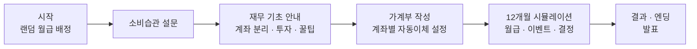
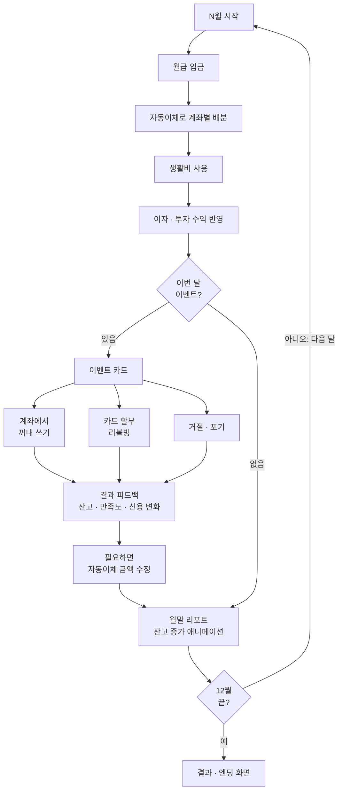
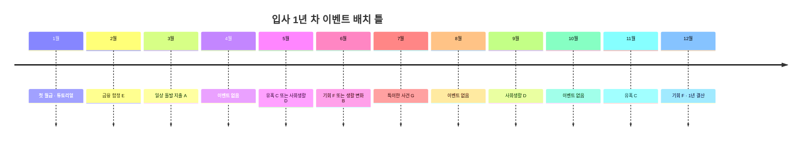
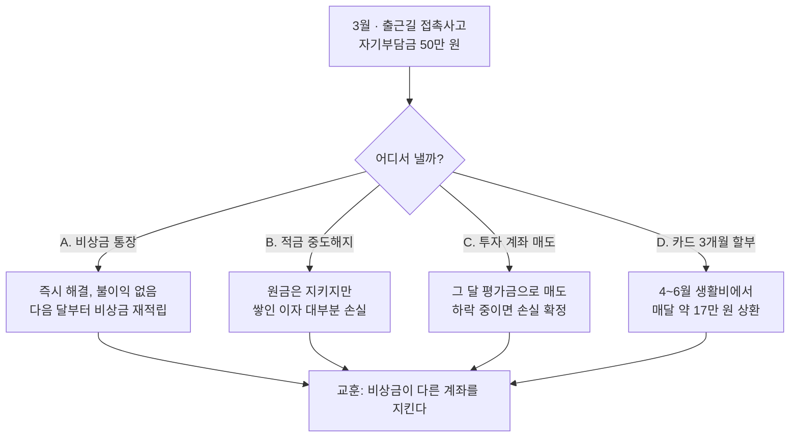

# 생성형 AI 활용 가계부 시뮬레이션 수업 기획서

- 작성일: 2026-10-26
- 팀: 이상민(수업지도안), 박태수(웹 데모), 김홍준
- 상태: 초안 v2 (12개월 시뮬레이션 반영)

---

## 1. 개요

학생이 첫 월급을 받은 사회초년생이 되었다고 가정하고 수업을 진행합니다. 학생은 생성형 AI의 도움을 받아 목적별 계좌로 돈을 나누는 가계부를 짭니다. 그다음 입사 1년 차 12개월을 시뮬레이션합니다. 시간이 지나면 계좌에 돈이 쌓이고, 중간중간 터지는 이벤트마다 어느 계좌의 돈을 어떻게 쓸지 학생이 직접 결정합니다.

| 항목 | 내용 |
| --- | --- |
| 주제 | 생성형 AI를 활용한 경제활동 참여: 내 첫 월급, 1년 살아 보기 |
| 시간 | 30~40분 |
| 형태 | 웹 배포 → 학생이 각자 접속해 개인별로 진행 → 몇 명 발표 |
| 핵심 장치 | 평균소득 ±10% 랜덤 월급, 소비습관 진단, 목적별 계좌 가계부, 12개월 시뮬레이션과 이벤트 |

### 기획 배경 (팀 논의 결과)

- 처음 계획한 모의투자는 학생에게 너무 어렵고, 가계부 작성만 하기에는 너무 쉽다는 의견이 나왔습니다.
- 그래서 가계부에 돌발 상황과 유혹 상황을 더하는 방식으로 난이도를 맞췄습니다. (이상민 제안)
- 학생의 소비습관부터 진단한 다음, 그 결과를 바탕으로 가계부를 추천합니다. 수업에서는 저축 계획과 소비 계획을 세우는 법을 함께 다룹니다. (김홍준 제안)
- 정해진 상황 카드를 한 번 보고 끝내지 않고, 시간이 흐르며 돈이 쌓이는 시뮬레이션으로 확장했습니다. 내가 내린 결정이 다음 달 잔고에 바로 남아서 결정의 결과를 직접 체감할 수 있습니다.

### 학습 목표

1. 수입을 저축, 고정비, 변동비로 나누어 한 달 가계부를 짤 수 있다.
2. 목적별로 계좌를 나누는 이유와 저축과 투자의 차이를 설명할 수 있다.
3. 예상하지 못한 지출이나 소비 유혹이 생겼을 때 어느 돈을 어떻게 쓸지 판단하고 가계부를 다시 조정할 수 있다.
4. 생성형 AI에게 질문해 가계부 작성과 의사결정에 참고할 수 있다.

---

## 2. 수업 흐름 (40분 기준)



| 단계 | 시간 | 활동 | 웹 화면 |
| --- | --- | --- | --- |
| 도입 | 3분 | "여러분은 오늘 첫 월급을 받았습니다" 상황 제시, 링크를 통해 접속 | 시작 |
| 소비습관 진단 | 4분 | 간단한 질문에 답하며 내 소비습관 확인 | 설문 |
| 재무 기초 안내 | 5분 | 선저축, 목적별 계좌 분리, 투자 첫걸음, 생활 꿀팁 | 안내 카드 |
| 가계부 작성 | 8분 | 추천안을 참고하고 AI에 질문하며 계좌별 배분 완성 | 가계부 작성 |
| 시뮬레이션 | 12분 | 12개월 진행, 이벤트마다 대응 결정 | 시뮬레이션 |
| 발표 | 6분 | 순자산 그래프와 엔딩을 보여 주며 2~3명 발표 | 결과 |
| 정리 | 2분 | 실생활 실행법과 마음가짐 정리 | 결과 하단 |

30분 버전에서는 시뮬레이션을 6턴(2개월씩 1턴)으로 압축하고 발표를 1~2명으로 줄입니다.

---

## 3. 교육 내용: 가계부 짜는 방법

### 3.1 소비습관 진단 질문

가계부를 쓰기 전에 학생 스스로 소비 성향을 확인하는 단계입니다. 답변 결과는 추천 가계부의 초기값으로 사용합니다.

| # | 질문 | 응답 형태 | 가계부 연결 |
| --- | --- | --- | --- |
| 1 | 한 끼 식사에 보통 얼마를 쓰나요? | 금액 구간 선택 | 식비 |
| 2 | 하루에 카페나 간식에 얼마를 쓰나요? | 금액 구간 선택 | 식비(간식) |
| 3 | 배달 음식은 일주일에 몇 번 시키나요? | 횟수 선택 | 식비 |
| 4 | 휴대폰 요금제는 어떤 것을 쓰나요? | 저가/일반/무제한 | 통신비 |
| 5 | 구독 서비스(OTT, 음악 등)는 몇 개인가요? | 개수 선택 | 구독료 |
| 6 | 주말 여가에 한 달 동안 얼마를 쓰나요? | 금액 구간 선택 | 여가/문화 |
| 7 | 사고 싶은 것이 생기면 어떻게 하나요? | 바로 산다 / 고민한다 / 참는다 | 소비 성향 유형 |
...

결과 화면에서는 소비 성향을 유형(예: 계획형, 균형형, 즉흥형)으로 보여 주고 한 줄 피드백을 함께 제공합니다.

### 3.2 기본 원칙

1. 선저축, 후지출: 월급이 들어오면 저축부터 떼어 두고 남은 돈으로 생활합니다.
2. 고정비와 변동비 구분: 매달 똑같이 나가는 돈과 내가 조절할 수 있는 돈을 나눕니다.
3. 비상금 확보: 갑자기 생기는 지출에 대비해 따로 모아 둡니다. 목표는 생활비 3~6개월분입니다.
4. 비율 가이드: 출발점으로 50/30/20 규칙을 소개합니다. 필수 지출 50%, 선택 지출 30%, 저축 20%입니다. 이 비율은 기준일 뿐이며 상황에 맞게 바꿔도 된다고 함께 안내합니다.

### 3.3 가계부 항목 체계

| 구분 | 항목 | 예시 |
| --- | --- | --- |
| 저축·투자 | 비상금, 적금, 투자, 청약, 목표 자금 | 월급날 자동이체 |
| 고정비 | 월세/관리비, 통신비, 보험료, 교통비, 구독료 | 매달 같은 금액 |
| 변동비 | 식비, 생활용품, 의류/미용, 여가/문화, 경조사비 | 조절 가능 |

### 3.4 목적별 계좌 분리 (통장 쪼개기)

돈에 이름표를 붙이는 방법입니다. 한 통장에 모든 돈이 섞여 있으면 얼마를 써도 되는지 알기 어렵습니다. 목적별로 나누면 생활비 통장 잔고만 보고 이번 달 남은 돈을 바로 알 수 있습니다.

| 통장 | 목적 | 상품 유형 예시 | 배분 예시 |
| --- | --- | --- | --- |
| 급여 통장 | 월급이 들어오고 자동이체가 출발하는 곳 | 주거래 은행 입출금 통장 | 거쳐 가는 곳 |
| 생활비 통장 | 고정비와 변동비 지출, 체크카드 연결 | 입출금 통장 | 50~60% |
| 비상금 통장 | 사고, 병원비 같은 진짜 비상 | 파킹통장, CMA (하루만 맡겨도 이자) | 10% (생활비 3개월분까지) |
| 저축 통장 | 1~3년 뒤 목돈 | 정기적금, 청년미래적금 | 15~20% |
| 투자 통장 | 10년 이상 장기 자산 | ISA 계좌 안의 적립식 ETF | 5~10% |
| 목표 통장 | 여행, 노트북 교체 등 계획된 큰 지출 | 입출금 통장, 자유적금 | 5% |
| 청약 통장 | 내 집 마련 자격 | 주택청약종합저축 | 2~25만 원 |

수업용 안내 문구: "생활비 통장에 돈이 없으면 이번 달은 끝입니다. 다른 통장은 이름표에 맞는 일에만 씁니다."

### 3.5 투자 첫걸음 (아주 간단히)

모의투자처럼 종목을 고르게 하지 않고, 저축과 투자의 차이만 체감하게 합니다.

- 저축과 투자의 차이: 예금과 적금은 원금이 보장되고, 2025년 9월 1일부터 금융기관별로 1억 원까지 예금자보호를 받습니다. 투자는 수익을 더 기대할 수 있지만 원금을 잃을 수도 있습니다.
- 위험과 수익은 함께 움직입니다. "원금 보장에 고수익"은 사기의 신호입니다.
- 복리와 시간: 월 10만 원씩 연 5%로 10년을 모으면 원금 1,200만 원이 약 1,550만 원이 됩니다. (설명용 가정 수익률)
- 분산과 적립식: 한 종목에 몰아넣지 않고, 시장 전체를 담은 지수 ETF를 매달 같은 금액만큼 삽니다. 사는 시점이 나뉘어 비쌀 때와 쌀 때가 섞입니다.
- ISA: 예금, 펀드, ETF를 한 계좌에 담는 절세 계좌입니다. 의무 가입 기간은 3년이고 수익 중 일정 한도까지 비과세됩니다.
- 순서가 중요합니다: 비상금 → 저축 습관 → 소액 투자. 비상금으로 투자하거나 빚을 내서 투자하지 않습니다.

### 3.6 생활 재무 꿀팁

제도 내용은 2026년 10월 기준으로 조사했습니다. 수업 전에 금융위원회, 국세청 공지로 다시 확인합니다.

| 꿀팁 | 내용 |
| --- | --- |
| 청년미래적금 | 2026년 6월 출시. 만 19~34세, 월 최대 50만 원, 3년 만기. 정부 기여금은 납입액의 6%(일반형) 또는 12%(우대형)이고 이자는 비과세입니다. 소득 요건이 있습니다. |
| 예금자보호 1억 원 | 한 금융기관의 예금과 적금을 원금과 이자 합계 1억 원까지 보호합니다. 큰돈은 여러 금융기관에 나눕니다. |
| 체크카드 활용 | 연말정산 소득공제율이 체크카드와 현금은 30%, 신용카드는 15%입니다. 생활비 통장에 체크카드를 연결하면 지출 한도도 저절로 생깁니다. |
| 무이자 할부와 리볼빙 주의 | 할부는 월 납입금이 아니라 총액으로 판단합니다. 리볼빙(일부결제금액 이월약정)은 남은 금액에 높은 이자가 붙습니다. |
| 신용점수 관리 | 소액이라도 연체하지 않습니다. 카드값, 통신요금을 자동이체로 기한 내에 냅니다. |
| 고정비 다이어트 | 알뜰폰 요금제, 쓰지 않는 구독 해지, 대중교통 환급 제도(K-패스 등) 확인. 고정비는 한 번 줄이면 매달 효과가 납니다. |
| 청약통장 | 월 납입 인정액이 25만 원으로 올랐습니다. 오래 유지할수록 유리하니 해지하지 않습니다. |
| 중소기업 취업 청년 소득세 감면 | 요건을 갖추면 5년간 소득세 90%를 감면받습니다(연간 한도 있음). 회사에 신청서를 내야 적용됩니다. |
| 연말정산 13월의 월급 | 카드 사용액, 월세, 청약 납입액 등이 공제됩니다. 월세 세액공제는 무주택 세대주 요건을 확인합니다. |
| 금융사기 예방 | 가족 사칭 메신저, 택배·저금리 대출 문자의 링크는 누르지 않습니다. 의심되면 직접 전화로 확인하고, 피해 시 은행과 경찰(112)에 바로 지급정지를 요청합니다. |
| 무지출 데이 | 일주일에 하루는 돈을 쓰지 않는 날로 정합니다. 습관 점검에 효과적입니다. |

### 3.7 가계부 실제 실행법 (정리 단계에서 안내)

- 자동이체: 월급날 다음 날 저축, 비상금, 투자, 고정비가 자동으로 빠져나가게 합니다.
- 기록 습관: 가계부 앱이나 카드 알림으로 지출을 기록하고, 일주일에 한 번 점검합니다.
- 월말 결산: 계획과 실제 지출을 비교해 다음 달 계획에 반영합니다.
- 비상금을 썼다면: 다음 달부터 비상금을 다시 채우는 금액을 가계부에 넣습니다.

### 3.8 유혹에 대비한 마음가짐

- 24시간 규칙: 계획에 없던 물건은 하루 지난 뒤에도 필요하면 삽니다.
- 할부의 함정: 월 납입금이 아니라 총액과 기간을 확인합니다.
- "이번 달만" 주의: 한 번 넘긴 예산은 다음 달에도 반복되기 쉽습니다.
- 비교 소비 경계: SNS에서 남이 쓰는 돈과 내 계획을 구분합니다.
- 비상금은 비상에만: 사고나 병원비가 비상이고, 세일은 비상이 아닙니다.
- 무조건 참기도 답이 아닙니다: 즐거움을 위한 돈도 목표 통장에 미리 모아 두면 죄책감 없이 쓸 수 있습니다.

---

## 4. 웹 서비스 화면 구성

모든 화면은 이전/다음 버튼과 진행 표시줄로 이동합니다. 학생이 자기 속도로 넘겨 가며 진행합니다.

1. 시작 화면
    - 닉네임 입력
    - 월급 랜덤 배정: 기준 평균소득 ±10% 범위, 1만 원 단위 반올림
    - 연출 예시: "축하합니다! ○○님의 첫 월급은 2,630,000원입니다"
2. 소비습관 설문: 3.1의 질문을 한 화면에 하나씩 보여 주고, 마지막에 소비 성향 유형을 표시합니다.
3. 재무 기초 안내: 3.2~3.6 내용을 카드 5~6장으로 보여 줍니다.
4. 가계부 작성
    - 설문 결과로 만든 추천 가계부를 초기값으로 채움
    - 지출 항목과 계좌별 자동이체 금액을 학생이 직접 수정
    - 합계, 남은 금액, 저축률, 계좌별 비율 막대를 실시간으로 표시
    - 합계가 월급과 정확히 맞아야 다음 단계로 넘어감
    - "AI에게 물어보기" 프롬프트 복사 버튼 (7장 참고)
5. 시뮬레이션 화면 (5장 참고)
    - 상단: 현재 월, 순자산, 만족도, 신용점수
    - 가운데: 계좌별 잔고 카드 (월급이 들어오면 숫자가 올라가는 애니메이션)
    - 이벤트 발생 시: 이벤트 카드 → 선택지 → 결과 피드백 → (선택) 가계부 조정
    - 이벤트 없는 달: "다음 달" 버튼 또는 2초 뒤 자동 진행
6. 결과 화면
    - 12개월 순자산 그래프와 계좌별 최종 잔고
    - 처음 가계부와 최종 가계부 비교 (항목별 증감 표시)
    - 이벤트별 선택 기록과 엔딩 칭호
    - 발표용 크게 보기 모드
    - 3.7~3.8 실행법과 마음가짐 요약

---

## 5. 시뮬레이션 설계

### 5.1 진행 규칙

- 1턴 = 1개월, 입사 후 1월부터 12월까지 12턴을 진행합니다.
- 매달 월급이 들어오고, 가계부에서 정한 자동이체대로 계좌에 나뉘어 들어갑니다. 시간이 지날수록 잔고가 쌓이는 것을 숫자와 그래프로 보여 줍니다.
- 수업 시연이 목표이므로 이벤트를 랜덤으로 뽑지 않습니다. 수업 전에 6.3의 예시 중에서 이벤트를 골라 월별로 배치해 두고, 모든 학생이 같은 달에 같은 이벤트를 겪습니다. 발표 때 "같은 상황에서 다른 선택"을 비교할 수 있습니다.
- 투자 수익률, 변동비, 이벤트 선택지의 결과도 미리 정해 둡니다. 시연할 때마다 같은 흐름이 재현되고, 학생 간 결과 차이는 운이 아니라 결정에서 나옵니다.
- 랜덤 요소는 처음 배정되는 월급(평균소득 ±10%) 하나만 둡니다.
- 이벤트를 처리한 뒤에는 언제든 가계부(자동이체 금액)를 조정할 수 있습니다.

### 5.2 한 달의 흐름



### 5.3 계좌별 규칙 (시뮬레이션용 가정값)

금리와 수익률은 학습용 가정값입니다. 실제 상품 금리가 아니라는 점을 화면에 표시합니다.

| 계좌 | 이자·수익 | 꺼내 쓸 때 | 배우는 점 |
| --- | --- | --- | --- |
| 생활비 | 없음 | 자유. 단 생활비가 바닥나면 다음 달 만족도 하락 | 이번 달 쓸 수 있는 돈의 한계 |
| 비상금 (파킹통장) | 연 2% | 자유, 불이익 없음 | 비상금이 있으면 결정이 쉬워짐 |
| 적금 (12개월 만기) | 연 3.5%, 12월에 만기 | 중도해지 시 이자가 연 0.5%로 줄어듦 | 묶인 돈과 중도해지 손해 |
| 투자 (적립식 ETF) | 미리 정한 월별 수익률 (예: 평소 -2%~+3%, 급락 이벤트 달 -15%) | 그 달 평가금으로 매도. 하락장에서 팔면 손실 확정 | 투자금은 장기로 묶어 둘 돈 |
| 목표 통장 | 연 2% | 목적에 맞게 쓰면 만족도 보너스 | 즐거움도 계획하면 부담이 없음 |
| 청약 | 연 2% | 해지하면 가입 기간이 0으로 초기화 | 오래 유지하는 것 자체가 자산 |
| 부채 (카드 할부·리볼빙) | 할부 수수료, 리볼빙 연 18% | 매달 상환액이 생활비에서 빠짐. 미납 시 신용점수 하락 | 빚은 미래의 월급을 당겨 쓰는 것 |

### 5.4 지표와 엔딩

| 지표 | 계산 | 화면 표시 |
| --- | --- | --- |
| 순자산 | 모든 계좌 잔고 - 남은 부채 | 숫자와 월별 그래프 |
| 비상금 개월 수 | 비상금 잔고 ÷ 월 생활비 | "3.2개월 버틸 수 있어요" |
| 만족도 (0~100) | 계획한 즐거운 소비, 목표 달성 시 상승. 생활비 부족, 무조건 거절이 반복되면 하락 | 이모지 게이지 |
| 신용점수 | 연체, 리볼빙, 현금서비스 이용 시 하락 | 등급 배지 |

돈만 모으면 만족도가 떨어지고 쓰기만 하면 순자산이 줄도록 설계해, 정답이 하나가 아니게 만듭니다.

| 엔딩 칭호 | 조건 |
| --- | --- |
| 균형 잡힌 재무설계자 | 순자산 상위 + 만족도 60 이상 + 부채 0 |
| 짠테크 장인 | 순자산 최상위, 만족도 40 미만 ("돈은 모았지만 조금 지쳤어요") |
| 욜로 라이프 | 만족도 80 이상, 비상금 1개월 미만 |
| 빚과의 동거 | 12월에 부채가 남아 있음 |
| 위기 탈출 전문가 | 비상금으로 돌발 이벤트 3개 이상 해결 |
| 사기 감별사 (보너스 배지) | 금융사기 이벤트를 모두 피함 |

---

## 6. 이벤트(시나리오) 설계

### 6.1 이벤트 카드 구조

| 필드 | 설명 |
| --- | --- |
| id, 제목 | 예: `car-accident`, "출근길 접촉사고" |
| 유형 | 일상 돌발 / 생활 변화 / 유혹 / 사회생활 / 금융 함정 / 기회 / 특이 |
| 배치 월 | 6.3에서 고른 뒤 지정하는 발생 월 |
| 상황 설명 | 2~4문장의 이야기 |
| 금액 | 고정 금액 또는 월급 대비 비율 |
| 선택지 | 2~4개. 선택지마다 사용 계좌, 잔고·만족도·신용 변화, 피드백 문구 |
| 조건 | 선택지 활성화 조건 (예: 비상금 50만 원 이상일 때만) |
| 핵심 교훈 | 한 줄 정리 |

### 6.2 이벤트 배치 방법

이벤트는 아직 확정하지 않습니다. 수업 전에 6.3의 예시 중에서 시연에 쓸 이벤트를 골라 아래 월별 칸에 배치합니다. 한 번 배치하면 모든 학생이 같은 순서로 같은 이벤트를 겪습니다.

배치 원칙

- 12분 시뮬레이션 기준으로 이벤트는 7~8개를 고릅니다. 이벤트 하나에 약 1.5분이 걸립니다.
- 1월은 튜토리얼로 두고, 이벤트 없는 달을 3개쯤 두어 돈이 쌓이는 모습을 보여 줍니다.
- 유형을 고르게 섞습니다. 일상 돌발, 유혹, 금융 함정, 사회생활, 기회, 특이한 사건이 한 번 이상 나오게 합니다.
- 비상금의 필요성이 드러나도록 일상 돌발 지출(A)은 초반(2~4월)에 둡니다.
- 증시 급락(F3)을 넣는다면 이후 회복하는 달을 남겨 둡니다.
- 12월은 1년 결산 달로, 성과급(F1)이나 적금 만기(F2)를 추천합니다.

월별 유형 틀 (예시)



| 월 | 유형 | 선택한 이벤트 | 후보 예시 |
| --- | --- | --- | --- |
| 1월 | 튜토리얼 | 첫 월급 (고정) | - |
| 2월 | 금융 함정 | (선택) | E1 택배 스미싱, E2 가족 사칭, E7 중고거래 |
| 3월 | 일상 돌발 지출 | (선택) | A1 접촉사고, A2 노트북 고장, A3 치과 |
| 4월 | 없음 | - | - |
| 5월 | 유혹 또는 사회생활 | (선택) | C2 해외여행 제안, D2 가정의 달, D3 돈 빌려 달라는 친구 |
| 6월 | 기회 또는 생활 변화 | (선택) | F3 증시 급락, F5 청년미래적금, B1 월세 인상 |
| 7월 | 특이한 사건 | (선택) | G1 아기 고양이, G2 주운 5만 원, G4 즉석복권 |
| 8월 | 없음 | - | - |
| 9월 | 사회생활 | (선택) | D1 추석과 결혼식, D4 회식 정산 |
| 10월 | 없음 | - | - |
| 11월 | 유혹 | (선택) | C1 블랙프라이데이, C5 한정판 운동화, E3 코인 리딩방 |
| 12월 | 기회 · 결산 | (선택) | F1 성과급, F2 적금 만기 |

### 6.3 이벤트 목록

아래는 고를 수 있는 예시 목록입니다. 시연에는 이 중 7~8개만 골라 씁니다. 금액은 예시값이며, 월급이 다른 학생에게도 공정하도록 월급 대비 비율로 바꿔 적용할 수 있습니다. 선택지의 결과(돌려받는 금액, 되판 가격 등)도 랜덤 없이 미리 정해 둡니다.

#### A. 일상 돌발 지출

| # | 이벤트 | 상황 | 금액 | 선택지 | 배울 점 |
| --- | --- | --- | --- | --- | --- |
| A1 | 출근길 접촉사고 | 보험 처리 후 자기부담금 발생 | 50만 원 | 비상금 / 적금 해지 / 투자 매도 / 카드 할부 | 비상금이 있어야 다른 계좌가 안전함 |
| A2 | 노트북에 커피를 쏟음 | 업무용 노트북 메인보드 고장 | 40만 원 | 수리 / 중고 구매 / 새 제품 12개월 할부 | 수리, 중고, 새것의 비용 비교 |
| A3 | 사랑니가 욱신욱신 | 사랑니 발치와 치과 치료 | 30만 원 | 비상금 + 실손보험 청구 / 치료 미루기 | 보험 청구, 미루면 더 커지는 비용 |
| A4 | 한여름 에어컨 고장 | 7월 폭염에 에어컨이 멈춤 | 25만 원 | 수리 / 선풍기로 버티기 (만족도 크게 하락) | 생활의 질도 비용임 |
| A5 | 지갑 분실 | 현금 5만 원과 카드가 든 지갑을 잃어버림 | 5만 원 | 즉시 카드 분실신고 / 내일 하기 (부정사용 위험) | 분실신고는 바로 |
| A6 | 윗집 누수 | 천장에 물이 새서 벽지가 젖음 | 0~30만 원 | 집주인·윗집에 연락 / 내 돈으로 몰래 수리 | 책임 소재를 먼저 확인 |

#### B. 생활 변화·고정비

| # | 이벤트 | 상황 | 금액 | 선택지 | 배울 점 |
| --- | --- | --- | --- | --- | --- |
| B1 | 월세 인상 | 재계약 때 월세 인상 통보 | 월 +5만 원 | 수용하고 다른 고정비 줄이기 / 이사 (이사비 80만 원) / 협상 | 고정비는 매달 누적됨 |
| B2 | 휴대폰 약정 만료 | 요금이 그대로 나가는 중 | 월 -3만~+6만 원 | 알뜰폰 + 쓰던 폰 / 새 폰 24개월 할부 | 통신비 다이어트 |
| B3 | 이직 제안 | 연봉 10% 인상 제안, 이사 필요 | 이사비 100만 원 | 이직 / 잔류 | 수입 증가와 초기 비용 |
| B4 | 회사 사정으로 무급휴직 | 한 달 동안 월급 없음 | 수입 0 | 비상금으로 버티기 / 카드로 버티기 | 비상금 개월 수의 의미 |
| B5 | 물가 상승 | 식비가 자동으로 8% 오름 | 월 +식비 8% | 가계부 조정 / 그대로 두기 | 가계부는 고정된 것이 아님 |

#### C. 유혹·소비

| # | 이벤트 | 상황 | 금액 | 선택지 | 배울 점 |
| --- | --- | --- | --- | --- | --- |
| C1 | 블랙프라이데이 | 최신 스마트폰 24개월 무이자 할부 | 총 144만 원 | 구매 / 24시간 뒤 다시 결정 / 목표 통장으로 구매 | 할부는 총액으로 판단 |
| C2 | 친구들의 해외여행 제안 | 다음 달 3박 4일 해외여행 | 150만 원 | 목표 통장 사용 / 카드 할부 / 거절 / 내년 여행 적금 시작 | 즐거움도 계획하면 부담이 없음 |
| C3 | SNS 맛집과 배달 | 주말마다 맛집 투어, 배달 반복 | 월 +15만 원 | 그대로 / 주간 식비 한도 설정 | 작은 지출의 누적 |
| C4 | 헬스장 12개월 회원권 | 12개월 일시불 50% 할인 | 60만 원 | 12개월 결제 (결과: 3번 가고 끝) / 1개월씩 결제 | 할인보다 실제로 쓸지가 중요 |
| C5 | 한정판 운동화 리셀 | "사서 되팔면 두 배"라는 친구 | 30만 원 | 구매 (결과: 리셀 가격이 떨어져 손해) / 패스 | 투자처럼 보이는 소비 |
| C6 | 콘서트 티켓팅 실패 | 암표 판매자가 3배 가격 제안 | 45만 원 | 구매 / 다음 공연 기다리기 | 암표와 사기 위험 |
| C7 | 무료 체험 구독 | 무료 체험이 끝나고 자동결제 | 월 1.5만 원 | 해지 / 유지 | 구독 정기 점검 |

#### D. 사회생활·관계

| # | 이벤트 | 상황 | 금액 | 선택지 | 배울 점 |
| --- | --- | --- | --- | --- | --- |
| D1 | 추석과 결혼식 2건 | 명절 비용과 축의금이 한 달에 몰림 | 35만 원 | 경조사비 항목으로 처리 / 생활비 줄이기 | 경조사비를 미리 예산에 넣기 |
| D2 | 가정의 달 | 어버이날 선물과 가족 외식 | 20만 원 | 선물 금액 정하기 / 마음을 담은 편지 + 소액 | 금액보다 계획 |
| D3 | 친구가 돈을 빌려 달라 함 | 급하다며 100만 원 요청 | 100만 원 | 빌려줌 (결과: 절반만 돌려받음) / 일부만 / 거절 | 돌려받지 못해도 괜찮은 금액만 |
| D4 | 회식 2차 계산 | 내 카드로 먼저 결제, 정산 메시지에 답이 없음 | 24만 원 | 정산 요청 다시 하기 / 그냥 넘어가기 | 정산은 그날 바로 |
| D5 | 동생 대학 입학 | 입학 선물과 노트북 지원 부탁 | 50만 원 | 지원 / 일부 / 마음만 | 가족 지출의 경계 |

#### E. 금융 함정·사기

| # | 이벤트 | 상황 | 금액 | 선택지 | 배울 점 |
| --- | --- | --- | --- | --- | --- |
| E1 | 택배 주소 확인 문자 | "주소 불일치로 배송 불가, 링크 확인" | 링크 클릭 시 -100만 원 | 링크 클릭 / 택배사 앱에서 직접 확인 / 삭제 후 신고 | 문자 속 링크는 누르지 않기 |
| E2 | 가족 사칭 메신저 | "엄마야, 폰 고장 나서 상품권 좀 사 줘" | 50만 원 | 상품권 구매 / 엄마에게 전화로 확인 | 송금 전에 전화 확인 |
| E3 | 코인 리딩방 초대 | 회사 동기가 "월 300% 수익 보장" 단톡방 초대 | 투자 시 전액 손실 | 전 재산 투자 / 소액만 시험 / 거절 | 원금 보장 고수익은 사기 신호 |
| E4 | 저금리 대환대출 문자 | "정부지원 저금리 대출, 수수료 선입금 필요" | 30만 원 | 선입금 / 금융기관에 직접 확인 | 대출 전 선입금 요구는 사기 |
| E5 | 부업 강의 광고 | "하루 1시간으로 월 천만 원" 강의 | 99만 원 | 결제 / 후기·환불 규정 확인 후 패스 | 쉽게 버는 돈은 없음 |
| E6 | 리볼빙 권유 | "이번 달은 최소 금액만 결제하세요" | 이자 연 18% | 리볼빙 / 전액 결제 | 리볼빙은 고금리 빚 |
| E7 | 중고거래 반값 태블릿 | 판매자가 안전결제 대신 계좌이체 요구 | 40만 원 | 계좌이체 / 안전결제 고집 / 직거래 | 중고거래 사기 예방 |

#### F. 기회·수입

| # | 이벤트 | 상황 | 금액 | 선택지 | 배울 점 |
| --- | --- | --- | --- | --- | --- |
| F1 | 성과급 | 연말 성과급 지급 | +50만 원 | 전부 쓰기 / 반반 / 전부 저축·투자 | 보상 소비와 저축 비율 |
| F2 | 적금 만기 | 12개월 적금 만기, 원금과 이자 수령 | 원금 + 이자 | 재예치 / 투자 / 목표 통장 | 만기 후 계획이 다음 목돈을 만듦 |
| F3 | 증시 급락 | 뉴스: "주가 지수 15% 하락" | 투자 계좌 -15% | 전부 매도 / 유지 / 오히려 추가 매수 | 이후 몇 달 동안 회복 (패닉셀 체험) |
| F4 | 금리 인상 뉴스 | 파킹통장 금리 상승 | 비상금 이자 증가 | 정보 확인만 | 금리가 내 통장에 주는 영향 |
| F5 | 청년미래적금 가입 공지 | 정부 지원 적금 가입 기간 안내 | 월 납입 선택 | 가입 / 미가입 | 정부 지원 제도 찾아보기 |
| F6 | 연말정산 환급 | 체크카드 사용 비율에 따라 환급액 결정 | +5만~30만 원 | 결과 확인 | 13월의 월급 |

#### G. 특이하고 재미있는 사건

| # | 이벤트 | 상황 | 금액 | 선택지 | 배울 점 |
| --- | --- | --- | --- | --- | --- |
| G1 | 출근길 아기 고양이 | 비 오는 날 상자 속 아기 고양이 발견 | 병원비 20만 원 + 월 7만 원 | 입양 (만족도 크게 상승) / 구조 단체 연결 | 반려동물도 매달 나가는 고정비 |
| G2 | 길에서 5만 원 주움 | 출근길 보도에서 5만 원 지폐 발견 | +5만 원? | 경찰서에 신고 / 그냥 가짐 | 습득물은 신고. 주인이 없으면 몇 달 뒤 습득자에게 돌아올 수 있고, 몰래 가지면 범죄가 될 수 있음 |
| G3 | 사내 장기자랑 1등 | 부서 대표로 나가 1등 | +30만 원 | 회식으로 쏘기 / 목표 통장 / 반반 | 공돈도 계획 |
| G4 | 즉석복권 당첨 | 편의점 즉석복권 5천 원으로 5만 원 당첨 | +5만 원 | 저축 / 복권 10장 더 사기 (기대값 공개) | 확률과 기대값 |
| G5 | 라면 1년 치 공동구매 | 개당 400원, 한 번에 365개 | 14.6만 원 | 구매 (보관 공간과 유통기한 문제) / 패스 | 대량 구매가 늘 이득은 아님 |
| G6 | 회사 골프 동호회 가입 권유 | 팀장님이 같이 하자고 함, 장비 필요 | 150만 원 | 새 장비 / 중고 장비 대여 / 정중히 거절 | 사회생활 비용의 범위 |
| G7 | 무지출 챌린지 유행 | 회사에서 "한 달 무지출 데이 10일" 챌린지 | 식비 -10만 원 | 참여 (성공 여부는 소비습관 진단 결과로 결정) / 불참 | 습관 실험 |
| G8 | 유명 맛집 오픈런 아르바이트 | 주말 줄 서기 대행 아르바이트 제안 | +8만 원, 만족도 하락 | 수락 / 휴식 | 시간과 돈의 교환 |

### 6.4 예시 대본 1: 출근길 접촉사고 (A1)

> 상황
> 입사 3개월 차, 출근길에 앞차와 가벼운 접촉사고가 났습니다. 다친 사람은 없지만 보험 처리 후 자기부담금 50만 원을 이번 달에 내야 합니다.
>
> 어디서 돈을 낼까요?
> - A. 비상금 통장에서 낸다
> - B. 적금을 깨서 낸다
> - C. 투자 계좌의 ETF를 팔아서 낸다
> - D. 카드 3개월 할부로 낸다
>
> 핵심 교훈: 비상금이 없으면 작은 사고도 몇 달 동안 가계부를 흔듭니다.



비상금 잔고가 50만 원보다 적은 학생은 A가 비활성화되고 "비상금이 부족합니다"라는 메시지가 나옵니다. 비상금의 필요성을 직접 체감하게 하는 장치입니다.

### 6.5 예시 대본 2: 회사 동기의 코인 리딩방 초대 (E3)

> 상황
> 친한 회사 동기가 단톡방 링크를 보냅니다. "여기 전문가가 찍어 주는 코인 사면 한 달에 300%래. 나도 벌써 50만 원 벌었어. 원금 보장도 해 준대!"
>
> 어떻게 할까요?
> - A. 이번 기회에 크게! 적금을 깨서 300만 원 넣는다
> - B. 일단 10만 원만 넣어 본다
> - C. 링크를 누르지 않고, 동기에게 사기일 수 있다고 알려 준다
>
> 선택 결과
> - A → 다음 달 단톡방이 사라지고 연락이 끊깁니다. 300만 원 전액 손실, 적금 이자도 손실됩니다.
> - B → 처음에는 화면상 수익 20만 원이 찍힙니다. "출금하려면 수수료 100만 원을 먼저 입금하세요"라는 요구가 옵니다. 입금하면 전액 손실, 거절하면 10만 원 손실로 끝납니다.
> - C → 손실 없음, "사기 감별사" 배지 진행도 +1. 동기가 고마워하며 커피를 삽니다 (만족도 소폭 상승).
>
> 핵심 교훈: "원금 보장 + 고수익"은 존재하지 않습니다. 출금하려면 돈을 더 내라는 요구는 전형적인 사기 수법입니다.

---

## 7. 생성형 AI 활용 방식

웹 안에 AI를 직접 넣지 않고, 단계별 추천 프롬프트를 복사해 학생이 AI 서비스에 질문하는 방식을 기본으로 합니다. API 키 관리, 비용, 서버 구축 부담을 피하기 위해서입니다.

| 단계 | 추천 프롬프트 예시 |
| --- | --- |
| 가계부 작성 | "나는 사회초년생이고 월급이 {월급}원이야. 한 끼 식비는 {식비}원 정도고 배달은 주 {횟수}번 시켜. 생활비, 비상금, 적금, 투자, 목표 통장으로 나누는 한 달 가계부를 표로 짜 줘." |
| 계좌 분리 | "파킹통장, 적금, ISA의 차이를 고등학생도 이해하게 설명해 줘. 각각 어떤 돈을 넣으면 좋을까?" |
| 돌발 지출 | "이번 달에 갑자기 {금액}원이 필요해졌어. 지금 내 계좌 잔고는 {계좌 요약}이야. 어느 계좌에서 꺼내는 게 가장 손해가 적을까?" |
| 유혹 상황 | "{물건}을 {개월}개월 할부로 사려고 해. 총액과 내 저축 계획에 주는 영향을 계산해 줘." |
| 증시 급락 | "내 투자 계좌가 한 달 만에 15% 떨어졌어. 지금 팔면 어떻게 되고, 기다리면 어떤 위험이 있는지 장단점을 알려 줘." |
| 사기 의심 | "이런 문자(제안)를 받았어: {내용}. 사기일 가능성이 있는지, 확인 방법을 알려 줘." |

프롬프트의 `{ }` 부분에는 학생이 입력한 값과 현재 잔고가 자동으로 채워집니다. AI 답변을 그대로 따르지 말고 자기 상황에 맞는지 판단하도록 안내합니다.

---

## 8. 기술 구현과 배포

| 항목 | 방안 |
| --- | --- |
| 형태 | 정적 웹앱 (HTML/CSS/JS, 필요하면 React) |
| 배포 | GitHub Pages, Netlify, Vercel 중 하나 + 접속 링크 |
| 데이터 저장 | 브라우저 localStorage (서버 없음, 새로고침해도 월급과 진행 상태 유지) |
| 시뮬레이션 상태 | 하나의 상태 객체: 현재 월, 계좌별 잔고, 부채, 만족도, 신용점수, 이벤트 기록 |
| 이벤트 데이터 | 별도 JSON 파일로 분리해 교사가 상황, 금액, 선택지를 쉽게 수정 |
| 고정 시나리오 | 이벤트 배치, 월별 투자 수익률, 선택지 결과를 JSON에 미리 정해 두어 시연마다 같은 흐름 재현 |
| 월급 생성 | 클라이언트에서 기준값 ±10% 난수 생성 후 저장 |
| 결과 그래프 | 12개월 순자산 선 그래프 (Chart.js 또는 직접 그린 SVG) |
| 기기 대응 | PC, 태블릿, 휴대폰 화면 모두 지원 (반응형) |
| 발표 | 결과 화면의 크게 보기 모드를 학생 화면 공유나 교사 PC로 표시 |

이벤트 JSON 예시:

```json
{
  "id": "car-accident",
  "type": "일상 돌발",
  "trigger": { "month": 3 },
  "title": "출근길 접촉사고",
  "text": "입사 3개월 차, 출근길에 앞차와 가벼운 접촉사고가 났습니다.",
  "cost": 500000,
  "choices": [
    {
      "label": "비상금 통장에서 낸다",
      "requires": { "emergency": 500000 },
      "effects": { "emergency": -500000 },
      "feedback": "비상금은 바로 이런 때를 위한 돈입니다."
    },
    {
      "label": "카드 3개월 할부로 낸다",
      "effects": { "debt": { "amount": 500000, "months": 3 } },
      "feedback": "앞으로 3개월 동안 생활비가 줄어듭니다."
    }
  ],
  "lesson": "비상금이 없으면 작은 사고도 몇 달 동안 가계부를 흔듭니다."
}
```

추후 확장으로 교사용 대시보드(반 전체 결과와 선택 통계 모아 보기)와 웹 내 AI 직접 연동을 검토할 수 있습니다. 둘 다 서버가 필요합니다.

---

## 9. 역할 분담

| 담당 | 업무 |
| --- | --- |
| 박태수 | 웹 데모 개발 (시뮬레이션 엔진, 이벤트 JSON), 배포 |
| 이상민 | 수업지도안 작성 |
| 김홍준 | (제안) 소비습관 질문과 추천 가계부 기준 정리 |

---

## 10. 결정이 필요한 사항

- [ ] 수업 대상 학년
- [ ] 기준 평균소득 금액과 근거 통계 (세후 월급 기준)
- [ ] 6.3 예시 중 시연에 쓸 이벤트 7~8개 선택 및 6.2 월별 배치
- [ ] 시뮬레이션 가정값 확정: 금리, 투자 변동 폭, 만족도와 신용점수 규칙
- [ ] 엔딩 칭호 조건의 구체적인 기준값
- [ ] 생성형 AI 사용 방식: 프롬프트 복사 방식 확정 여부, 사용할 AI 서비스와 학생 연령 이용 조건 확인
- [ ] 수업 기기 (컴퓨터실 / 태블릿 / 개인 휴대폰)
- [ ] 발표 인원과 발표 방식
- [ ] 데모 완성 목표일과 리허설 일정

---

## 참고 자료

2026년 10월 26일에 확인했습니다. 수업 전에 공식 공지로 다시 확인합니다.

- [청년미래적금 출시일, 신청기간, 조건 (토스뱅크)](https://www.tossbank.com/articles/youth-grow-up-account)
- [2026 청년미래적금 출시·조건·혜택 총정리 (고방)](https://gobang.kr/contents/7821)
- [9월 1일부터 예금자보호 1억 원까지 (SBS Biz)](https://biz.sbs.co.kr/amp/article/20000248391)
- [사회초년생 월급 관리 노하우: 통장 쪼개기와 ISA, 청약](https://infoarounds.com/%EA%B2%BD%EC%A0%9C%EC%A0%95%EB%B3%B4/salary-management-tips-for-new-employees/)
- [통장 쪼개 종잣돈 쌓기 (이투데이)](https://www.etoday.co.kr/news/view/1120152)
